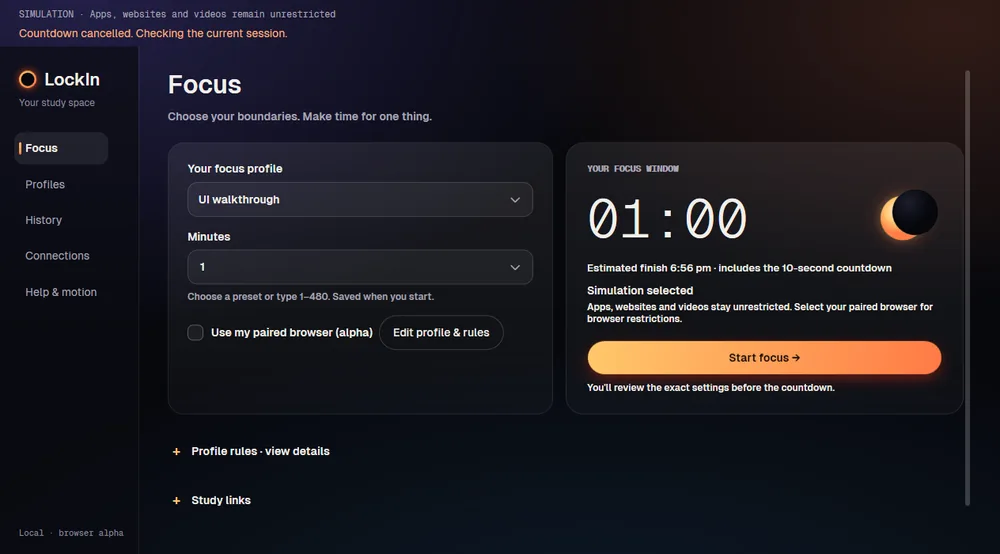
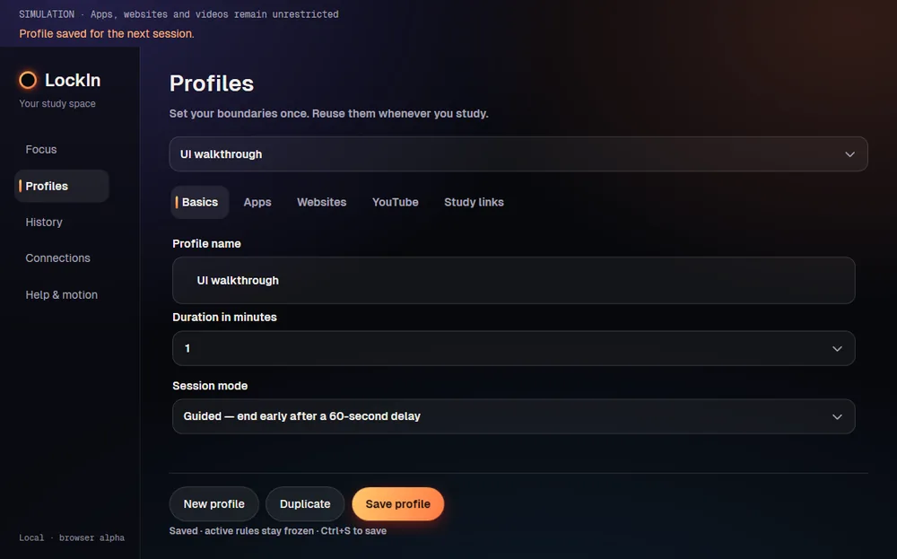
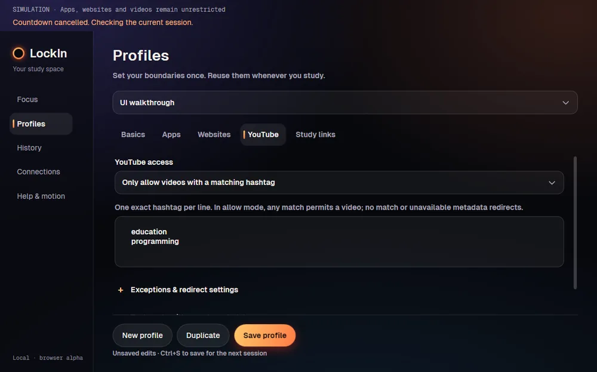
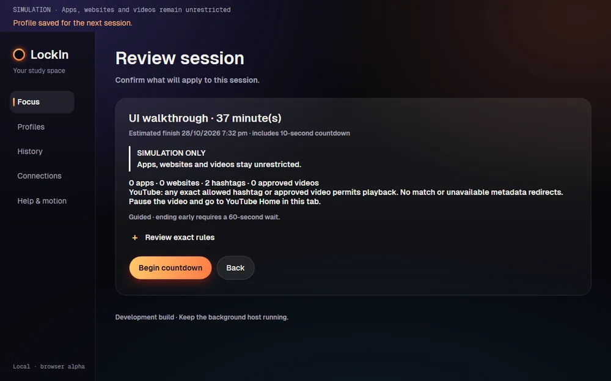
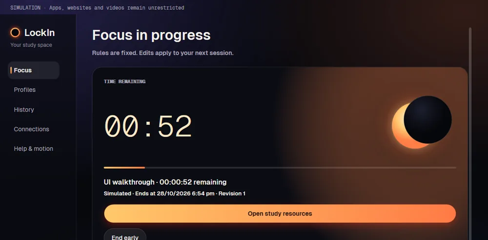
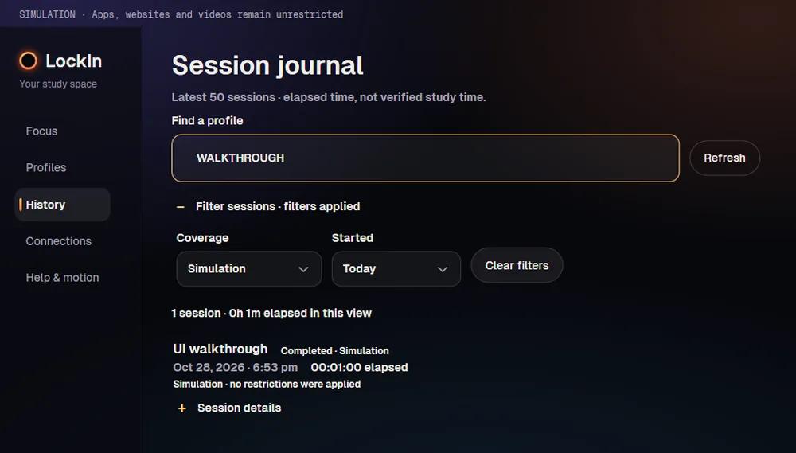

# LockIn

A Windows study-focus app with a browser extension. You set your rules once in a profile (allowed websites, study links, and YouTube videos with an approved hashtag), then start a session. Once it starts, the rules are fixed until it ends, so a tired moment can't undo a good plan.



> **Status:** developer alpha, not production ready. The desktop app, the local host and the browser extension work end to end, and a simulation mode runs everything without blocking anything. Still to do: installed-browser acceptance tests, closing desktop apps, Windows 11 testing and packaging. See [status](docs/STATUS.md).

## Walkthrough

*Screenshots use simulation mode, so nothing is blocked.*

**1. Set your rules once.** A profile holds the session length, mode, allowed websites, YouTube rules and study links.



**2. Allow only the right videos.** YouTube plays only videos with an approved hashtag or an approved link; everything else redirects.



**3. Review before it locks.** The exact rules that will apply are shown once more, then a 10-second countdown begins that you can still cancel.



**4. Focus.** The rules are fixed for the session. Edits made now apply to the next one. The eclipse shows the session's state.



**5. Read it back.** The history lists every session with elapsed time and what was enforced, with search and filters.



## Features

- **Profiles:** session length, mode, allowed websites (subdomains included, or exact hosts), HTTPS study links, and YouTube rules by hashtag or approved video
- **Fixed rules:** a session's rules can't change once it starts; the deadline is stored by the host, not the window
- **Survives restarts:** closing the window keeps the session, and restarting the host reconciles the original deadline
- **Guided early end** that releases after a 60-second wait, plus an owner-reported recovery path
- **Browser extension** for Chromium-based browsers (tested with Brave), paired with the desktop app through a code
- **History** of the latest sessions, with search, filters and elapsed totals
- **Simulation mode** that runs the whole flow with no browser or system restrictions
- **No account, no cloud, no telemetry;** data stays in a local SQLite file for the current Windows user

## How it's built

```
Desktop app (WPF) ──named pipe──► Local host (current-user process, SQLite)
                                          ▲
Browser extension ──native messaging──► Native host
```

- **LockIn.Core:** session rules, deadlines and validation, with no UI or OS dependencies
- **LockIn.Infrastructure:** the SQLite store (`LocalStore`)
- **LockIn.Service:** the local host that owns sessions and the database; one live session at a time
- **LockIn.Desktop:** the WPF app
- **LockIn.NativeHost:** the bridge between the browser extension and the host
- **extension/:** the browser extension (TypeScript): website redirects, the YouTube filter, the popup and the blocked page

## Engineering highlights

- **One source of truth:** the host enforces the countdown and deadline, so closing or killing the desktop app changes nothing.
- **Safe upgrades:** the database schema is versioned; upgrading backs up the old file first, and a corrupt database is kept for diagnosis instead of being silently replaced.
- **Hard-to-bypass rules:** exact hashtag matching for YouTube, unavailable video metadata redirects instead of allowing, and a trailing-dot hostname can't slip past a website rule.
- **Resilient bridge:** browser message failures retry, back off, and still release at the deadline.
- **Tested:** 54 .NET tests (including Windows host-process tests on temporary data), 15 extension unit tests, Playwright browser tests in disposable Chromium profiles, and scripted desktop walkthroughs.

## Tech stack

| Part | Technology |
| --- | --- |
| Desktop and host | .NET 10, C#, WPF, named pipes |
| Data | SQLite (Microsoft.Data.Sqlite) |
| Browser | Chromium extension in TypeScript, native messaging |
| Tests | xUnit, Node test runner, Playwright |

## Quick start

Requires Windows, the .NET 10 SDK, and Node.js 24 for the extension.

```powershell
dotnet build LockIn.slnx
dotnet test LockIn.slnx
powershell.exe -NoProfile -ExecutionPolicy Bypass -File scripts/start-simulation.ps1
```

The last command builds the solution, starts the host in the background and opens the desktop in simulation mode. In **Profiles**, create a 1-minute profile, then choose **Start focus**.

Full instructions for building, the extension, recovery and the Windows test walkthroughs are in the [development guide](docs/DEVELOPMENT.md). Real browser setup is in [browser alpha](docs/BROWSER_ALPHA.md).

## Documentation

- [Development guide](docs/DEVELOPMENT.md): build, run, test, recovery and data
- [Browser alpha](docs/BROWSER_ALPHA.md): pairing the extension, release and recovery
- [Status](docs/STATUS.md), [decisions](docs/DECISIONS.md) and [production readiness](docs/PRODUCTION_READINESS.md)
- [Design system](docs/DESIGN_SYSTEM.md) and [third-party notices](docs/THIRD_PARTY.md)
- [Development notes](docs/dev-notes/): the original build plan, specs, UI redesign, audits and handoff reports
