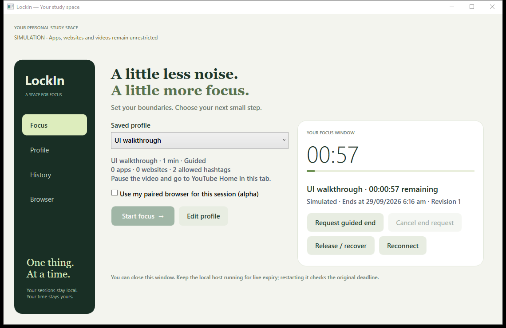
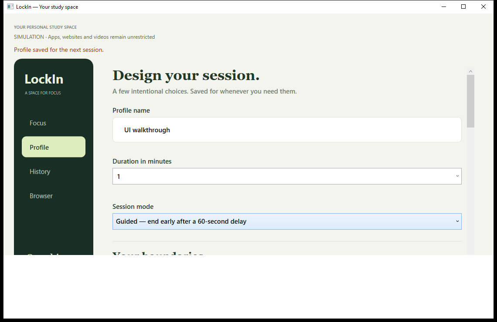
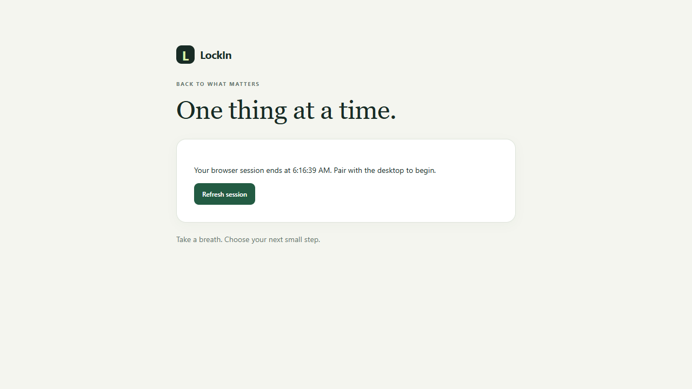

# Handoff 3 — Allow tags, browser alpha and frontend design

Date: 2026-09-29. Request: continue toward production, allow only entered YouTube tags, prioritize functions before design, report each handoff.

## Delivered

### YouTube behavior

New profiles default to `allowMatchingTags`. Any exact entered tag permits a video after compatibility/case normalization. Nonmatching/unavailable current-video hashtags redirect. Exact approved IDs remain an explicit exception. Editor, preview, preflight and both matchers agree. Legacy profiles retain block semantics and serialized hash shape; running snapshots are immutable.

### Browser functionality and recovery

- Enrollment codes expire after two minutes, are single-use and allow five attempts. Random installation credentials are stored as hashes by the host in schema 3.
- Native host validates configured extension origin, bounded stdio frames and a three-command allowlist. Desktop recovery/profile/session commands are not exposed through this bridge.
- Host stages the exact profile hash and requested origins. Readiness is checked at preparation and commit. Alpha permits Guided browser-only profiles.
- Activating is persisted before sending policy; exact acknowledgment makes it Active. Missing acknowledgment or interrupted activation requests compensating release.
- Extension installs owned top-level website redirects, handles already-open blocked tabs, registers YouTube content scripts and acknowledges installation. Derived cache never extends an existing deadline.
- Expiry/recovery removes owned rules, registered scripts and cache and releases video gates. Local expiry works without a host. Host remains CleanupPending until acknowledgment.
- Supported YouTube pages require matching URL, canonical video ID and current metadata before title/description hashtags are used. Stale metadata is not borrowed from the preceding video. Actions include same-tab redirect, existing destination activation and one replacement tab.
- Explicit setup/removal helpers supplied but not executed. See [setup and recovery](../BROWSER_ALPHA.md).

### UI/UX

Added forest navigation rail, sage accents, cream surfaces, serif headings, rounded controls and side-by-side setup/timer panels. Browser pairing/staging/readiness and scope are visible. Simulation remains labeled; history distinguishes scope. Extension popup and focus/blocked pages share the design.

Walkthroughs caught and fixed a missing WPF selected-content template part and completion text overwritten by refresh. Screenshot review led to a shorter default window and side-by-side layout so session controls stay visible.

## Verification

| Command/check | Result |
| --- | --- |
| Local SDK `dotnet build LockIn.slnx` | 0 warnings/errors |
| `dotnet test LockIn.slnx --no-build` | 45 passed, 0 failed/skipped |
| `npm.cmd run typecheck` / `npm.cmd run build` | Passed |
| `npm.cmd test` | 5 policy tests passed |
| `npm.cmd run test:browser` | 5 isolated Chromium tests passed |
| `scripts/test-desktop.ps1 -EditorOnly` | Passed save/reopen/edit |
| `scripts/test-desktop.ps1` | Passed on final layout, including wall-clock one-minute completion |
| Register/unregister helper syntax | Parsed; no registry changes executed |

New .NET cases cover allow semantics, legacy serialization, bad credentials, missing/stale readiness, revocation, exact acknowledgment, premature release rejection, activation timeout/restart and expiry cleanup. Native process tests cover framed identity and command/origin rejection.

Chromium tests exercise actual DNR rules, content scripts, current-page tags, gate removal for allowed tags, three tab actions and stale metadata rejection. Transport is absent: the harness seeds a derived policy cache in an isolated extension copy. Production bundles contain no test hook. These tests do not establish installed native registration or the whole product connection.

Evidence:

- Final full walkthrough: `%TEMP%\lockin-ui-4329b0c6e8f14042a3146d6cc577f6b1`.
- Editor round trip: `%TEMP%\lockin-ui-93aed6efd82249f9b6beaf24b340dafa`.
- Browser captures: `extension/test-results` (ignored); selected captures copied to `docs/images`.
- Disposable browser profiles: `%TEMP%\lockin-chromium-*`.

## Limits and next milestone

No installed Windows service, app closure, native registration, user-browser extension or browser/OS policy was changed. Simulation remains unrestricted. Owned test processes were stopped. Temporary test artifacts remain for diagnosis.

This is an M3/M4 developer alpha, **not production ready**. Installed bridge, permission dialogs, live YouTube/SPA, worker restart/offline recovery, lost enrollment cleanup, coverage health, Windows 11/sleep/reboot, accessibility/scaling and packaging remain open. Coverage is limited to the enrolled browser profile and supported `www.youtube.com` pages. No creator/private-tag access, zero-frame playback, administrator resistance or incognito/other-browser coverage is claimed.

Next: installed bridge and release/recovery verification before widening restrictions. See [BACKLOG](../BACKLOG.md) and [STATUS](../STATUS.md). The original plan is preserved; owner-requested changes are in [DECISIONS](../DECISIONS.md).
