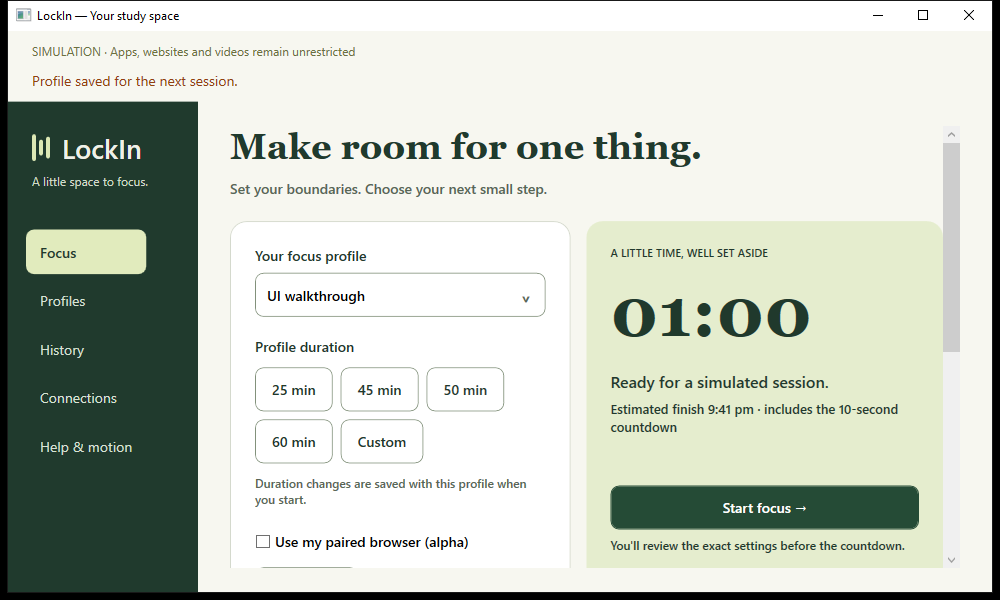

# Handoff 6 — Quiet study room redesign

Date: 2026-09-29. Request: review and apply the supplied UI/UX redesign, retain functionality, and add motion.

## Review and implementation

Reviewed the specification, HTML prototype and verification document under `UI redesign`, plus the original build plan and project decisions. Rendered the prototype for visual comparison. The prototype's mock values and implied enforcement are not product capabilities.

- Applied the forest navigation rail, warm paper canvas, sage session ticket, serif headings, three-stroke mark, rounded controls and visible focus indicators to the real WPF application.
- Split profile editing into Basics, Apps, Websites, YouTube and Study links. Save remains outside the scrolling fields; validation selects the relevant section. Profile selection, duplicate, persistence and rule preview remain available.
- Added duration shortcuts, inline preflight review, explicit countdown presentation, a dark active-session ticket and state-appropriate actions. The existing host still prepares/commits sessions and controls deadlines and recovery.
- Active summaries and study links use the frozen session profile. Study links open only after a click. Editing during a session is labeled as affecting the next session.
- Kept Connections and added a stable Help & motion destination for recovery and owner-removal controls. Compact windows use labeled top navigation; short windows hide decorative rail copy and retain scrollable navigation.
- Added finite 240 ms navigation transitions, 180 ms save feedback and 250 ms progress interpolation. Timer digits do not bounce or animate every second. Windows animation preferences take precedence; a window-local reduce-motion checkbox is also available.
- Matched extension popup/focus/blocked-page styling. CSS honors system reduced motion; the extension's local preference persists. Confirmed the popup fits a 320 px viewport.
- Preserved exact entered YouTube allow-tag semantics, approved-video overrides, legacy profile compatibility, explicit browser-alpha setup and honest simulation labels. No host enforcement behavior changed.

## Findings and fixes during verification

The first WPF launch exposed a root resource lookup failure; root colors now use dynamic lookup after the merged dictionary loads. Visual inspection found the custom selector displaying a profile record instead of its name; forwarding its item template selector fixed this. A short-window screenshot exposed vertical navigation wrapping into clipped columns; scrollable navigation and hiding decorative copy at short heights fixed it.

One browser fault-injection test intermittently failed because popup/startup reconciliation could overwrite its externally injected expired deadline. The test now uses an inert extension page and awaits startup synchronization before injecting the failure. The full suite passes, and the storage-failure regression passed three additional consecutive runs. Its immediate-release and no-reactivation assertions remain intact; production release code was not changed for this harness issue.

## Verification

| Check | Result |
| --- | --- |
| .NET solution build | Passed, zero warnings/errors, including final navigation fix |
| .NET tests | 48 passed, zero failed/skipped |
| Extension typecheck/build | Passed |
| TypeScript policy tests | 5 passed |
| Isolated Chromium suite | 8 passed |
| Storage-failure regression repetition | 3 additional passes |
| WPF editor round trip | Passed save/reopen and all grouped policy fields |
| WPF one-minute session | Passed countdown cancellation, activation, close/reopen, original deadline, expiry/history |
| WPF browser recovery | Passed reported coverage, permission loss and owner-removal recovery with simulated browser messages |
| WPF design walkthrough | Passed final build: 640×600 navigation, reachable save, validation routing, reduced-motion preference and review cancellation |

The full session and recovery walkthroughs ran before the final selector/short-window presentation fixes; the design walkthrough and solution build ran after them. Tests use disposable data and test-owned processes. Browser pages are synthetic; two browser cases simulate native replies. No installed-native or live-YouTube verification is claimed. No service installation, user app closure or browser/OS policy changes were performed.

## Evidence and remaining work

[Compact review screenshot](../images/redesign-compact-review-2026-09-29.png). Temporary desktop evidence: `lockin-ui-fbd0e30fdd184219b6f181d5310eb0ad` (session), `lockin-ui-8eb3fded9ce2458dab071207daa5baf2` (recovery), `lockin-ui-cd36aed0a6534a8eaf28bd7060cd8aa1` (final design).

Still a developer alpha. Installed native pairing, live YouTube, remaining restart/recovery cases, privileged app enforcement and packaging remain release gates. Full keyboard/screen-reader, Windows 11 and 100/150/200% display-scaling audits remain open. The WPF reduce-motion override is window-local; the browser override is persisted. No dark theme or prototype-only capabilities are claimed.
