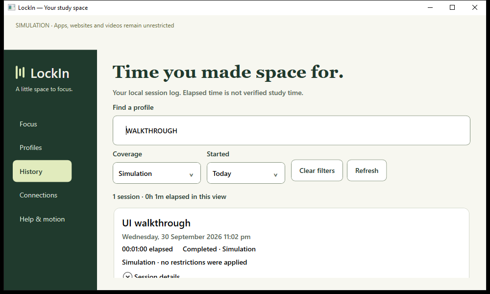

# Handoff 7 — Compact editing and useful session history

Date: 2026-09-30. Request: continue UI optimization, redesign and feature improvements.

## Implemented

- Replaced the horizontally crowded History table with readable session cards. Each card retains scope, outcome and cleanup evidence and can reveal the original deadline, finish time and completion reason.
- Added case-insensitive profile search, scope filters, Today/Last 7 days filters using local calendar dates, clear filters, matching-session totals and distinct empty/no-match states. The UI explicitly says it shows the latest 50 host records; totals describe the filtered snapshot, not lifetime productivity or verified study time.
- Reduced the editor heading and removed repeated subtitle text in short windows, giving rule fields more room while keeping Save and the simulation banner visible.
- Added visible unsaved/saved draft status and Ctrl+S through the existing validated save path. Active session rules remain frozen. The first validation issue now also appears in the top status message, so a field error below the scroll viewport is still understandable.
- Study resource buttons display the host plus path/query, distinguishing multiple lessons on the same website. Opening remains an explicit click and active links still come from the frozen session profile.
- Preserved the previous finite motion and reduced-motion support, exact entered YouTube allow-tag semantics, host authority and release/recovery controls.

## Verification and findings

Verification results are recorded in STATUS.md. Expanded the Windows walkthrough to verify dirty/saved feedback, empty history, case-insensitive search, coverage/date filters, reset and an elapsed total against a real-time one-minute simulation.

| Check | Final evidence |
| --- | --- |
| Solution build | Zero warnings/errors |
| .NET tests | 48 passed |
| Extension typecheck/build and policy tests | Passed; 5 policy tests |
| Browser suite | 7 passed, 1 timeout; that case passed isolated rerun in 7.9 seconds |
| Full WPF session/History | Isolated rerun passed, including original deadline and filtered 1-minute total |
| Final WPF design check | Passed, including empty History and dirty/saved status |

No backend or browser production code changed in response to the transient failures. Their causes remain unconfirmed. The successful sequential rerun retained all assertions and deadlines.

The screenshot precedes the final clarification that History shows the latest 50 host records. [Final compact editor screenshot](../images/editor-compact-2026-09-30.png).

Temporary evidence: `lockin-ui-231d83a56d6a414188482f79095df3a8` (initial failed walkthrough, preserved database), `lockin-ui-07c36e5240bb4d40b8d34aff3100acf3` (passing session/History), `lockin-ui-c223cde404ca4a9e889fde0e037c9f90` (final design).

The first session walkthrough encountered a storage-unavailable response. Read-only inspection of its preserved database returned `integrity_check: ok` and showed the session completed at its original deadline with 60 elapsed seconds. One browser test also exceeded its existing 45-second timeout. Low free disk space (about 318 MB) was observed, but causation was not established. Automatic approval review rejected removal of the current run's temporary Chromium folders with “blocked by policy”; those folders were left intact. No assertion or timeout was weakened.

## Boundaries

The history cache is presentation-only and does not authorize or extend a session. No session schema, enforcement provider or browser policy changed. Tests use isolated data; browser fixtures are synthetic and native replies are simulated in two cases. Installed native integration, live YouTube, full accessibility/scaling, privileged app enforcement and packaging remain release gates. Keyboard shortcut code is implemented; automated checks exercise its shared save path rather than injecting a system-wide keystroke.
