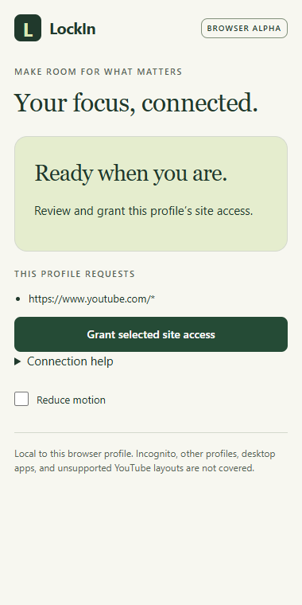

# Handoff 14 — Fix the setup experience

The owner reported that connection still failed and that too many manual steps made the app unusable.

## Implemented

- Desktop **Connect browser** now saves/validates and stages the profile, generates a short-lived setup code, copies it, and selects browser scope. Clipboard failure leaves the readable code available.
- The extension pairs automatically after a complete six-digit code is pasted. A retry button remains; browser naming and manual connection checks are secondary, collapsed controls.
- Added a restricted, read-only `GetBridgeStatus` native command mapping to host capabilities. The popup checks actual connectivity before pairing; it no longer waits for an attempted pairing to discover a missing bridge.
- Start automatically prepares the current browser profile and waits for readiness before review/countdown. There is no separate mandatory Send profile or Refresh step. Missing browser permissions still require an explicit browser gesture; restrictions never start silently.
- Fixed repeated permission prompts: the popup now hides site-access actions when the requested origins are already granted.
- Simplified Connections wording/actions; advanced resend/refresh/disconnect actions are collapsed. Recovery remains accessible.
- Created the owner's **LockIn** desktop shortcut. It opens the existing build via `-SkipBuild`, avoiding a terminal command and recompilation at every launch. This is a developer-build launcher, not an installer.
- Published a versioned native runtime under the existing Brave installation and updated its manifest path, preserving the original binaries. The allowed extension origin remains unchanged.

## Connection diagnosis and actual verification

Directly tested the installed Brave executable with the real extension at its original path/ID in an isolated temporary profile. Native messaging reached the installed bridge. After the changes, the visible popup reported the desktop connected; filling the code paired automatically; the running host reported that temporary browser connected. The helper then revoked only its own uniquely named enrollment and closed its temporary browser. It did not start a session or grant site permissions.

This is real Brave lookup/pairing evidence, unlike the earlier direct-executable probe. It does not establish the state of the owner's already-open profile; that unpacked extension must reload once to load the changed code.

| Check | Result |
| --- | --- |
| Solution build | Passed, zero warnings/errors |
| .NET suite | 49 passed |
| Extension typecheck/build | Passed |
| Policy tests | 5 passed |
| Chromium regression suite | 9 passed |
| Installed Brave popup connectivity and automatic pairing | Passed twice, temporary enrollment revoked afterward |
| Desktop browser recovery | Passed after fixing the walkthrough's preflight timing assumption |
| PowerShell parsing and shortcut launch | Passed; updated desktop opened |

The initial desktop walkthrough looked for the review only once, then waited for a native dialog. Automatic staging added an asynchronous step before the inline review. Updated the harness to wait for either actual confirmation surface; the recovery rerun passed without weakening assertions. Evidence: `%TEMP%\lockin-ui-01c53f4623824bbfaacfb09f73ee0ea7`.

## Remaining limits

The one-time unpacked-extension reload remains necessary during development. Site permissions still require Brave approval. Installed Brave policy activation/release and live YouTube need further evidence. No Windows service or real app blocking is implemented; no restrictions were applied to the owner's browser by these setup changes. The earlier failure in the owner's profile was not reproduced in the isolated Brave profile, so it is not claimed conclusively resolved there.

The optional `extension/probe-brave.mjs` is an explicit installed-setup diagnostic, not part of ordinary tests. Set `LOCKIN_PROBE_PIPE` to the running host's pipe before invoking it. It issues a fresh pairing code (invalidating an older unused one), creates and revokes a temporary enrollment, and never starts a session.
