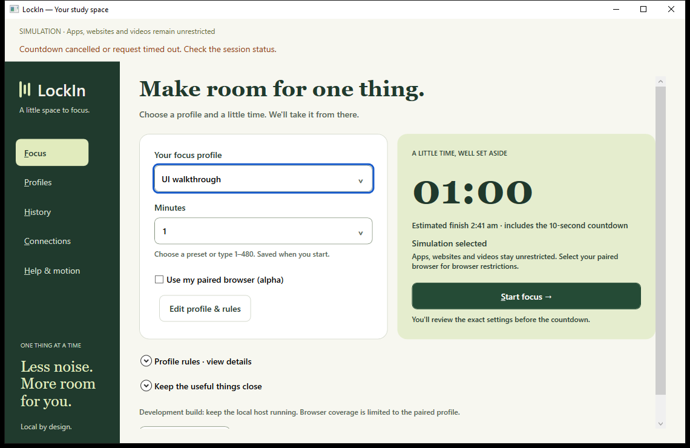
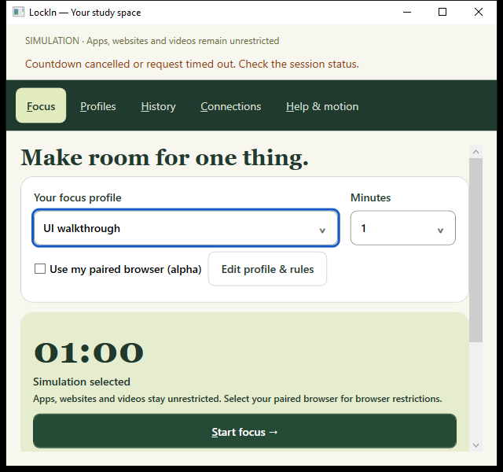

# Handoff 15 — Systematic desktop UX refactor

## Approach

Read the build plan, current status/decisions and existing UI before implementation. Wrote [the research and acceptance plan](../UX_REFACTOR_PLAN.md) first, using Microsoft navigation guidance, NN/g progressive disclosure/recognition, Fluent motion and W3C focus visibility guidance. Applied those principles to the existing WPF app.

## Accomplished

- Replaced five duration buttons with one editable selector. Custom minutes are available directly on Focus and remain synchronized with the profile editor.
- Added contextual readiness beside Start: simulation, host unavailable, incompatible browser-alpha profile, checking, unpaired, disconnected, access preparation and connected. These are derived from host reports; connection never claims active protection.
- Kept one profile/rules editing entry and moved rule details into an expander. Review, countdown, active-session controls, resources and recovery remain available.
- Separated initial browser setup from the connected state. Setup collapses after enrollment; the paired card leads back to Focus. Resend/check/disconnect remain under Manage connection.
- Extracted readiness presentation from the main update method. Added shared surface/secondary-action styles, collapsed blank feedback and removed redundant idle text.
- Replaced page translation with a finite 180 ms fade. Existing Windows and window-local reduced-motion behavior remains; timer digits do not animate.
- Improved compact layout after screenshot inspection showed Start was too low: profile and duration sit side by side, navigation/header spacing is reduced, redundant idle information is hidden. At the tested 640×600 size Start is fully visible; smaller/other scaling configurations can still require scrolling.
- Added Release selection to launch/test helpers. The owner's existing Debug window locked its executable, so validation used a separate Release build. The LockIn desktop shortcut now selects that build. No owner application was closed.

## Verification

| Check | Result |
| --- | --- |
| Release solution build | Passed, zero warnings/errors |
| .NET suite, Release | 49 passed |
| Expanded WPF design walkthrough | Passed: 37-minute custom duration reaches review/save; missing-browser action navigates to setup; disconnected/access/ready/revoked reports update guidance; setup collapses after enrollment; compact Start/save, validation routing, reduced-motion preference and review cancellation |
| WPF full session walkthrough | Passed: countdown cancellation, close/reopen with same deadline, automatic expiry, completed history and filters |
| WPF browser recovery | Passed: coverage/permission-loss display, pending cleanup, original-deadline gate, owner-reported removal evidence and enrollment revocation |
| WPF editor persistence | Passed: study links, approvals, tab action/destination survive save/reopen/edit |
| Changed PowerShell scripts | Parse passed; shortcut arguments and Release artifacts verified |

The initial Debug build failed because the running owner's executable was locked. The separate Release build resolved that build-environment conflict. No source compile error was reported. The compact layout adjustment addressed an observed usability failure; screenshot capture now waits for the short fade to settle.

Evidence directories under `%TEMP%`:

- Design: `lockin-ui-c61c64b4e7de4315b88441ca615c136a`
- Full session/history: `lockin-ui-b86f6c1b16fb48b68da6128d7090f6a3`
- Browser recovery: `lockin-ui-40033a694c404eef94d7f563b8c6d440`
- Editor: `lockin-ui-e25d08ca162544d4a181f2784145aa90`

Browser-state actors in desktop tests are simulated and use isolated pipes/databases. They install no restrictions. Extension code/native registration were not changed in this milestone; handoff 14's installed Brave pairing evidence remains historical. This turn does not claim new live-browser enforcement evidence or a full accessibility audit.

## Screenshots

Screenshots include feedback from a deliberately cancelled test countdown. Profiles and connection actors are test fixtures.

## Owner handoff and remaining work

Close the old LockIn window when convenient and open the **LockIn** desktop shortcut to see this build. Closing the UI does not stop a host-owned session. The shortcut remains a local development launcher, not a production installer.

This milestone completes the planned desktop ease-of-use pass. Production remains blocked on installed browser permission/activation/release acceptance, live YouTube and remaining recovery cases, real Windows app enforcement/service, packaging, accessibility/scaling and clean-machine validation. No service, browser/OS policy or real app restrictions were installed by these checks.
