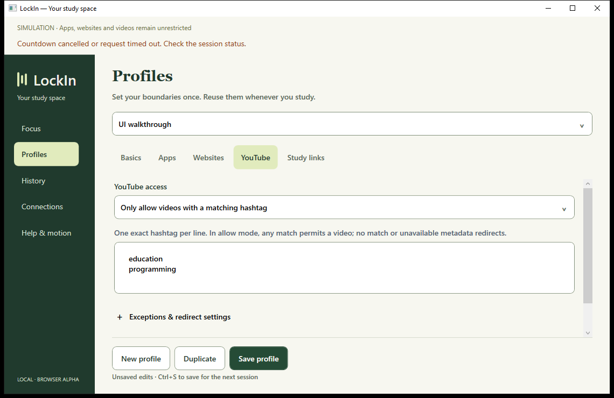
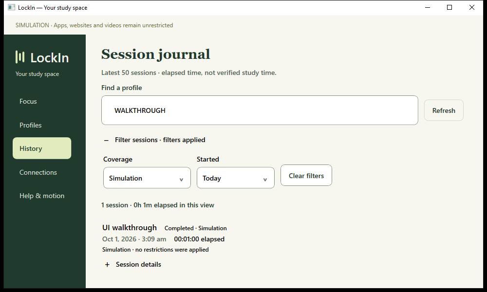
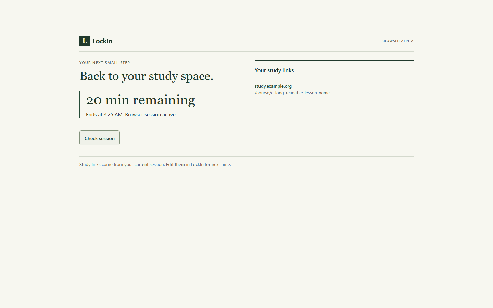
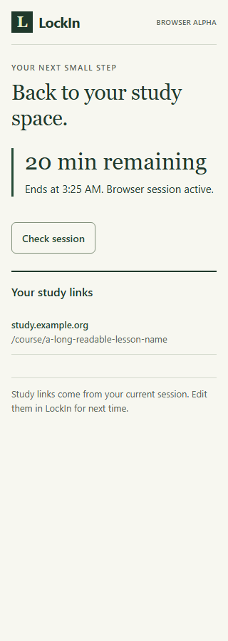
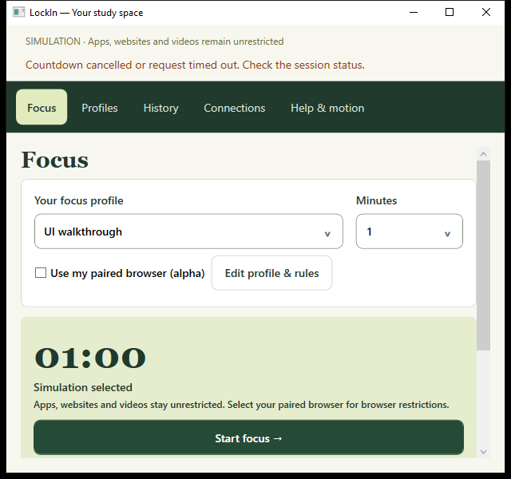
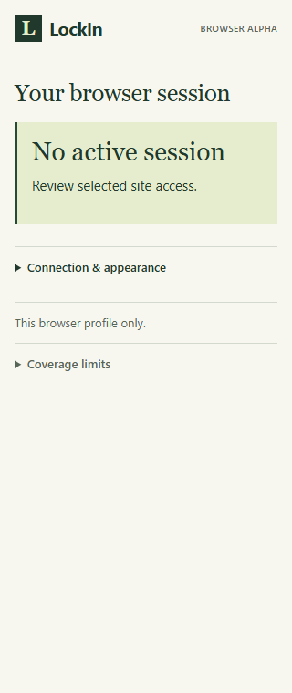

# Handoff 16 — Frontend audit, redesign and interaction pass

## Audit before code

Read the owner's attached brief, the build plan, status/decisions and actual WPF/extension frontend code. Published a concrete audit table before implementation. The [audit](../UI_AUDIT_16.md) maps each screen to its user task and observed issues. The [design system](../DESIGN_SYSTEM.md) records the resulting visual and interaction rules.

## Implemented

- **Navigation and hierarchy:** compact native branding, clear task-oriented page titles, smaller serif headings and less repeated copy. Preserved stable destinations and keyboard access.
- **Profiles:** exact hashtag entry remains prominent. Optional approvals, tab action and destination share an expandable group; validation opens that group when needed. Removed empty validation spacing and clarified field labels. Existing settings still save/reopen correctly.
- **Journal:** replaced rounded record cards with compact rows. Search/refresh share a toolbar; secondary filters are disclosed with an applied-filter indicator. Added refresh loading feedback. Cleanup evidence remains visible.
- **Connections and Help:** shorter setup instructions, flat help/recovery sections and preserved explicit recovery conditions. Removed repeated help actions from Focus.
- **Shared native components:** reusable spacing/control values, flat section/supporting-text styles and a labeled 44px disclosure control with hover/focus feedback.
- **Browser popup:** task-led setup/session states, compact code entry, secondary appearance/coverage disclosures, disabled/busy actions and permission-denial feedback. Paste-to-pair and explicit permission gestures are preserved. Focus moves to a visible heading when setup/access disappears.
- **Browser study/blocked pages:** split session/resource composition on wide screens, one column on narrow screens, clear empty/loading/error states and HTTPS study-link rows. Polling preserves unchanged link elements and keyboard focus. Failed checks no longer leave an uncaught initial-page rejection or a misleading stale status. Unconfirmed cleanup is labeled Recovery needed.
- **Motion:** shared 180ms web fades, retained native 180ms page fades and reduced-motion controls. No timer-digit animation or enforcement dependency on motion.

## Verification and fixes from review

| Check | Result |
| --- | --- |
| Release solution build | Passed, 0 warnings/errors |
| .NET suite | 49 passed |
| Extension typecheck/build | Passed |
| Policy tests | 5 passed |
| Existing isolated Chromium enforcement/recovery/motion tests | 9 passed |
| New browser presentation tests | 2 passed, including six viewport widths, focus retention, denied/granted access, failed/recovered status and unconfirmed cleanup |
| Desktop design/readiness | Passed: compact layout, disclosures, validation, reduced motion, inline duration, host-derived states and review cancellation |
| Desktop editor | Passed: settings survive save/reopen/edit with the new disclosure |
| Desktop session/history | Passed: cancellation, unchanged deadline after reopening, expiry, search/filters and journal results |
| Desktop browser recovery | Passed: permission loss, pending cleanup, original deadline and owner-reported removal evidence |
| Static color contrast | Text pairs 5.02:1–11.60:1; input border/white 3.34:1 |

The first combined browser run passed 10/11 cases; the remaining test looked for an empty alert through the accessibility tree even though empty alerts are intentionally hidden. Corrected the assertion to inspect the DOM element and reran the two presentation cases successfully. A wrong-directory runner attempt failed before test discovery; verification used the project's installed runner from `extension`, without changing project dependency versions.

The native design harness initially queried Help before its controls appeared. It now waits for the control. Captures were moved fully on screen to avoid clipped off-screen rendering. Visual review then increased the tag field enough to show its default entries and tightened journal rows/toolbar. Final desktop walkthroughs ran sequentially against the final Release build.

Native evidence directories under `%TEMP%`:

- Design: `lockin-ui-167f25541b794d90aec3992bc83c8400`
- Editor: `lockin-ui-e50de2b1b923408bb7cf0146efe80c0b`
- Session/history: `lockin-ui-cfce133802c94a13b3cf04640b302d5d`
- Recovery: `lockin-ui-2fab2deb53bd41398b3670114167177d`

Browser evidence is in `extension/test-results` (existing suite) and `extension/test-results-presentation` (focused final run). Browser presentation cases mock messages; enforcement cases use isolated browser fixtures. Neither establishes live YouTube compatibility or installed-Brave activation/release acceptance.

## Screenshots

### Profile editor and journal

### Browser study page

### Compact desktop and popup

Screenshots use test data; cancellation feedback is from a deliberate test action. A popup fixture message is simulated, not evidence of the owner's browser state.

## Handoff and remaining limits

Reopen the **LockIn** desktop shortcut to load the updated Release build. Reload the unpacked extension at `brave://extensions` to load its new UI. The existing owner window/host were left running; no service, OS/browser policy or native registration changed.

This completes the requested frontend pass across the existing major screens. It is not a production-release claim: live YouTube, installed browser permission/activation/release, Windows app enforcement/service, packaging/repair/uninstall and clean-machine acceptance remain open. Full screen-reader, high-contrast and physical DPI/display testing are still required. Desktop stays a native app with a 620px minimum, not a 320px mobile interface.
