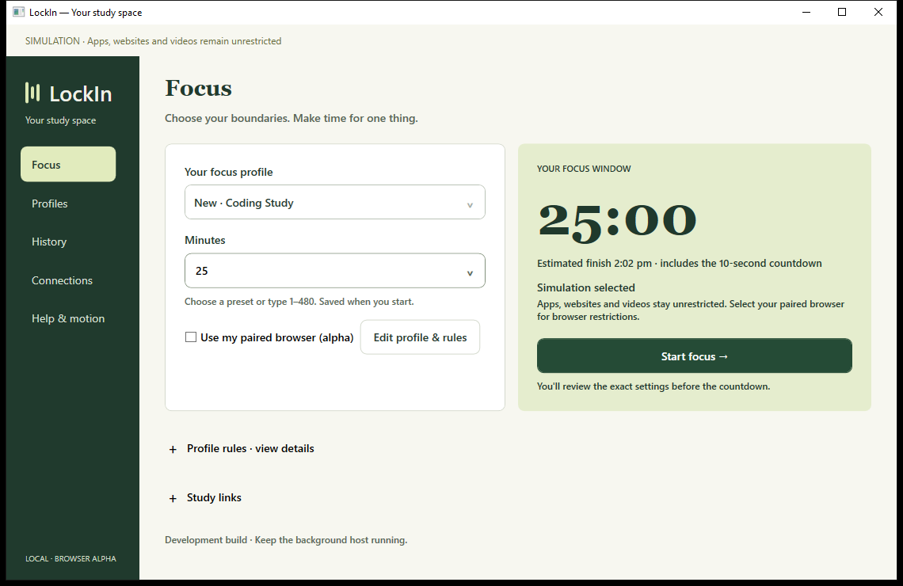
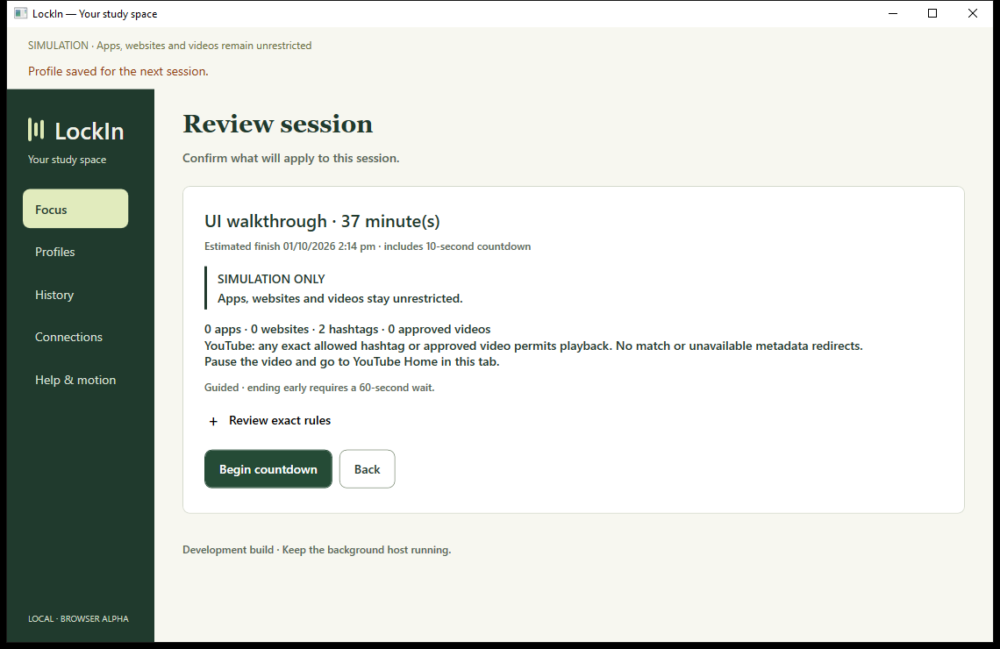
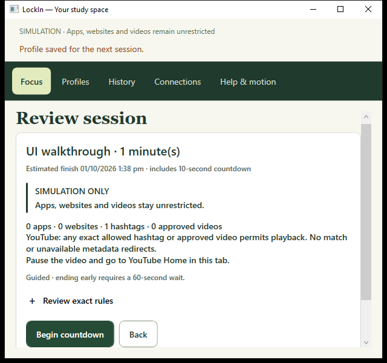

# Handoff 17 — First use and session review

Continued the frontend work after the owner's follow-up. The [short audit and plan](../UX_FOLLOWUP_17.md) was written before editing. This builds on the [full frontend redesign](2026-10-01-16-frontend-design-system.md).

## Accomplished

- New/duplicated drafts now show their name in both profile selectors instead of an empty selection. A selector with no saved options is disabled; the draft remains editable and can be reviewed/started normally.
- The custom destination URL appears only for Custom HTTPS. Switching to a built-in destination preserves the typed URL for a later switch back.
- Replaced the review paragraph with a profile/time heading, separate scope warning, rule summary, commitment mode and expandable exact entries. The selected browser name and tab-replacement consequences remain visible.
- Review details include exact application paths, website scope, hashtags, approved video IDs and study links. All review content comes from the validated snapshot captured by Start; changing the editor while review is pending does not change that snapshot.
- Fixed approved-video-only allow-list wording: it correctly states that all other videos redirect. It is no longer described as having no restriction rules.
- Hide the ordinary profile/resources summaries while reviewing, avoiding competing descriptions of saved versus pending rules. Tightened compact review padding.
- Validation opens optional settings and targets the correct visible control. Built-in destination conflicts focus the destination selector; custom URL errors target the URL field.
- Distinguished countdown cancellation from a request timeout, while retaining a host status check and avoiding unsupported claims about whether activation occurred.

## Verification

| Check | Result |
| --- | --- |
| Release build | Passed, zero warnings/errors |
| .NET suite | 49 passed |
| Expanded design walkthrough | Passed: named first use, scope labels, exact approved-only rules, frozen review snapshot, review cancellation and destination-error keyboard focus |
| Editor persistence | Passed: custom URL survives switching destinations, save, reopen and edit |
| Browser recovery walkthrough | Passed: selected browser identified in review; activation/coverage, permission loss and deadline-gated owner recovery retained |
| Full session/history walkthrough | Passed: cancel, close/reopen with unchanged deadline, expiry, completed history and filters |

The new keyboard assertion initially failed after the destination's tab/disclosure was revealed. Focus is now scheduled after layout, and the test establishes keyboard focus on Save before invoking validation. The subsequent test confirms the visible destination selector receives keyboard focus. This follows [Microsoft's WPF focus guidance](https://learn.microsoft.com/en-us/dotnet/desktop/wpf/advanced/focus-overview). No fixed sleep was added to production focus handling.

Evidence under `%TEMP%`:

- Final design: `lockin-ui-a46894fb80fd433798b49080ae28dbac`
- Editor: `lockin-ui-39c402ec88ec45399ee1565e8f0a949a`
- Browser recovery: `lockin-ui-750a20b8b0ab4e439810e7d022875d44`
- Full session/history: `lockin-ui-dd51ad8c67f8467286c43a30733e3de3`

The browser recovery actor is simulated through an isolated pipe/database and applies no real browser restriction. This continuation changed desktop presentation only; handoff 16's extension results remain the relevant browser frontend evidence.

## Screenshots

## Owner handoff

Reopen the LockIn desktop shortcut for the updated Release build. If the handoff 16 extension UI has not been loaded yet, reload LockIn once at `brave://extensions`.

Host authority, permission consent, review/countdown and release/recovery remain intact. No owner application was closed; no service, browser/OS policy or native registration changed. Production gates are unchanged: installed-browser lifecycle/live YouTube acceptance, Windows app enforcement/service, packaging and broader accessibility/platform validation.
