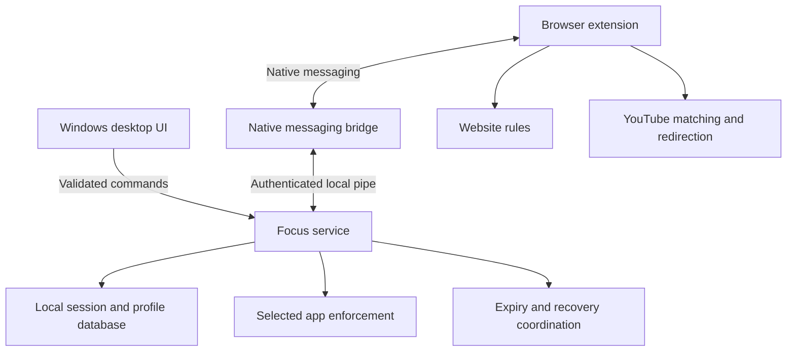

# LockIn — Full-Scale Product and Engineering Plan

**Working name:** LockIn. This is a placeholder, not a cleared product name.  
**Document version:** 1.0  
**Prepared:** 26 September 2026  
**Audience:** The project owner and Codex implementing the application.  
**Deliverable:** A Windows study-focus application, background enforcement service, and companion browser extension.  
**Status:** Implementation specification. No application has been built or tested by this document.

> Build an easy, customizable tool that temporarily restricts distracting PC applications and websites, redirects distracting YouTube videos, keeps the restrictions active when its window closes, and reliably restores access when the session ends.

## Contents

1. [How to use this plan](#1-how-to-use-this-plan)
2. [Product goal and honest boundaries](#2-product-goal-and-honest-boundaries)
3. [Decisions and default configuration](#3-decisions-and-default-configuration)
4. [Release scope and priorities](#4-release-scope-and-priorities)
5. [User journeys](#5-user-journeys)
6. [Screens and interaction design](#6-screens-and-interaction-design)
7. [Customization and profiles](#7-customization-and-profiles)
8. [System architecture](#8-system-architecture)
9. [Technology and development environment](#9-technology-and-development-environment)
10. [Repository organization](#10-repository-organization)
11. [Session lifecycle](#11-session-lifecycle)
12. [Time, restart, expiry, and recovery](#12-time-restart-expiry-and-recovery)
13. [Windows application enforcement](#13-windows-application-enforcement)
14. [Optional Windows launch prevention](#14-optional-windows-launch-prevention)
15. [Website blocking](#15-website-blocking)
16. [YouTube detection and matching](#16-youtube-detection-and-matching)
17. [YouTube redirection and tab handling](#17-youtube-redirection-and-tab-handling)
18. [Browser connection and coverage](#18-browser-connection-and-coverage)
19. [Data model and persistence](#19-data-model-and-persistence)
20. [Communication contracts](#20-communication-contracts)
21. [Permissions and security](#21-permissions-and-security)
22. [Privacy and local reporting](#22-privacy-and-local-reporting)
23. [Packaging, installation, and updates](#23-packaging-installation-and-updates)
24. [Performance and accessibility targets](#24-performance-and-accessibility-targets)
25. [Testing strategy and acceptance cases](#25-testing-strategy-and-acceptance-cases)
26. [Implementation milestones](#26-implementation-milestones)
27. [Risk register and unresolved decisions](#27-risk-register-and-unresolved-decisions)
28. [Owner operating guide](#28-owner-operating-guide)
29. [Codex execution instructions](#29-codex-execution-instructions)
30. [Copyable Codex kickoff prompt](#30-copyable-codex-kickoff-prompt)
31. [Release definition of done](#31-release-definition-of-done)
32. [Official references and verification notes](#32-official-references-and-verification-notes)

## 1. How to use this plan

### For the owner

- Start with sections 2–7 for the product experience and defaults.
- Read sections 13–18 to understand what application blocking, YouTube filtering, and strictness actually mean.
- Use section 28 when trying the first build.
- Give this entire file to Codex in the project repository. Use the prompt in section 30 to begin.
- Expect staged, working builds. A polished interface alone does not establish that desktop blocking, browser integration, or recovery works.
- Confirm the detected Windows version and preferred browser during implementation. The defaults below let development begin without waiting for every preference.

### For Codex

1. Read the whole document, then inspect existing repository instructions and code before editing.
2. Create an implementation backlog mapped to milestone IDs and acceptance-test IDs.
3. Build the simulation and session lifecycle before enabling real PC restrictions.
4. Complete each milestone with its required verification and update the project handoff notes.
5. Distinguish implemented, simulated, and unverified functionality in the UI and documentation.
6. Use the default decisions unless the owner changes them or a verified platform limitation requires a documented adjustment.
7. Keep this plan and the actual implementation synchronized; do not silently drop the YouTube redirect requirement or substitute website-only blocking for PC application blocking.

**Terminology:** “Must” is a release requirement for its assigned phase. “Should” is an intended default with room for a documented implementation choice. “Later” is explicitly outside the initial release. Performance figures are targets to measure, not achieved results.

## 2. Product goal and honest boundaries

### 2.1 Problem

The owner studies on a PC but can quickly switch to social media, YouTube entertainment, Steam, or games. Manually deciding against every distraction is tiring. The product should let the owner make those choices once, before a study session, and have the computer enforce the selected boundaries for a fixed period.

### 2.2 Required outcomes

| ID | Outcome |
| --- | --- |
| GOAL-01 | Start a saved study session with a clear duration and one main action. |
| GOAL-02 | Temporarily restrict selected desktop apps, including Steam and selected game executables. |
| GOAL-03 | Restrict selected websites while leaving study resources usable. |
| GOAL-04 | Detect configured distractions in available YouTube metadata and automatically move away from the video. |
| GOAL-05 | Let the owner choose the destination and whether to reuse the tab, switch tabs, or open one replacement tab. |
| GOAL-06 | Keep a session independent of the desktop window and browser window being open. |
| GOAL-07 | Restore normal access automatically at the deadline, including after sleep or restart. |
| GOAL-08 | Work locally without an account, cloud backend, or paid inference service. |
| GOAL-09 | Be understandable to a nontechnical user while offering advanced customization. |

### 2.3 What makes this useful for this owner

The intended advantage is the combination of configurable application restrictions, selective YouTube filtering, tab redirection, and ready-to-start study profiles. The system should explain a block in plain language and return the owner to useful study material.

Do not claim that a new build is more secure, more reliable, or harder to bypass than Cold Turkey without comparative testing. “Better for my workflow” is the initial product goal.

### 2.4 Boundaries to communicate accurately

- An extension alone cannot control Steam or guarantee that the browser stays open. Desktop enforcement needs the installed Windows component.
- Browser closure is allowed. The session continues and restrictions are reapplied when relevant components resume.
- A user with administrator control can ultimately alter local software and policies. This is a voluntary focus aid, not an administrator-proof security boundary.
- Detecting and closing an application after launch is different from preventing its process from launching. The UI must identify which enforcement method is active.
- Hashtags and creator tags are different metadata sources. Not all videos expose either. A missing field is not evidence that a video is educational.
- Content inspection may happen after the page starts loading. Do not promise zero frames or zero milliseconds of distracting content in every case.
- YouTube changes its page structure. Filtering requires maintenance and graceful degradation.
- The timer controls access; it does not prove that the owner studied or paid attention.
- Free local operation does not imply unlimited free Codex usage, free code-signing certificates, or free public distribution services.

### 2.5 Explicit non-goals for version 1

No kernel driver, antivirus interference, hidden persistence, keyboard interception, forced browser trapping, disabling Task Manager, remote monitoring, screen recording, cloud accounts, social feed, gamified pressure, mandatory AI classification, payments, or mobile app. Do not change unrelated firewall, DNS, hosts-file, browser, or organization policies.

## 3. Decisions and default configuration

These are product decisions, not guesses about the owner's actual hardware. Setup must detect and display the actual environment.

| Area | Initial decision |
| --- | --- |
| Target OS | Windows 11 x64 first; Windows 10 and ARM64 require separate compatibility verification. |
| Browser order | Chrome desktop first, then Edge using a separate tested installation profile. |
| UI language | English initially; keep display strings localizable. |
| Storage | Local only, authoritative service-owned SQLite database. |
| Default duration | 25 minutes; presets 25, 45, 50, 60; custom 1–480 minutes. |
| First-run test | Offer a 1-minute demonstration before real study sessions. |
| Default session | Fixed end time; time continues during browser closure, sleep, and reboot. |
| Start countdown | 10 seconds after preflight, cancelable before enforcement begins. |
| Default completion | Automatically release restrictions; do not reopen blocked apps or videos. |
| Default focus mode | Guided mode initially; Committed mode is an explicit choice after the demonstration. |
| Default application engine | Windows service detects and closes selected applications; accurately labeled. |
| Launch prevention | Separate advanced capability, gated behind Windows capability checks and rollback tests. |
| YouTube behavior | Filter configured metadata; redirect a matching watch page to YouTube Home in the same tab. |
| Other redirect options | Switch to an existing Home tab; open a replacement destination tab; Focus Page; approved lesson; custom approved HTTPS destination. |
| YouTube Home feed | Recommend “Hide recommendations on Home,” with an explicit toggle in setup. Home remains an allowed destination when selected. |
| YouTube missing metadata | Guided filtering allows with a coverage indicator; approved-video mode blocks unapproved or unresolved videos. |
| Allowed study videos | Exact video IDs; approved channels are an optional broader exception. |
| Logging | Aggregate counters enabled; detailed history off by default. |
| Recovery | Documented local recovery route from the first enforcement build. |

**Priority of preferences:** The owner can change these defaults before a session. An active session uses an immutable snapshot. Future profile edits do not silently weaken or strengthen the running session.

## 4. Release scope and priorities

### 4.1 Version 1 must include

- Desktop dashboard, profile editor, application picker, site list editor, and YouTube rule editor.
- A timer with a fixed deadline and a service-owned lifecycle.
- A simulated mode usable without changing the PC.
- Selected-application detection and closure with clear disclosure before starting.
- Website blocking in the connected browser, including already-open selected sites.
- Available-metadata YouTube filtering, exact video exceptions, and all three required tab behaviors.
- Feed/Shorts/recommendation controls on supported YouTube pages.
- Local browser-to-service communication and honest browser coverage status.
- Expiry, sleep, restart, component-crash, and uninstall recovery handling.
- A personal-use installer workflow, quick-start instructions, and a release validation record.

### 4.2 Version 1.1 / advanced local release

- Edge support after Chrome passes end-to-end tests.
- Optional Windows launch-prevention provider on verified machines.
- Scheduled sessions with local timezone and daylight-saving behavior specified.
- Multi-block study sessions with predetermined breaks.
- Previewed Steam-library discovery, broader executable identity matching, and app-update reconciliation.
- Profile import/export, aggregate CSV reports, optional channel rules, and accessibility refinements.
- Optional restricted study-browser setup, tested separately from ordinary browser coverage.

### 4.3 Later, only after the core is reliable

Firefox, macOS, Linux, optional local content classification, shared profile templates, and multi-device sync. Do not begin these to avoid solving Windows and YouTube edge cases.

### 4.4 Feature priority rules

1. Correct expiry and recovery come before strictness.
2. Correct rule matches and useful study exceptions come before large preset lists.
3. Real Windows and browser integration come before dashboards and visual polish.
4. Simple profile reuse comes before advanced scheduling.
5. A failed capability must be visibly unavailable; do not simulate success in a release build.

## 5. User journeys

### 5.1 First-run setup

1. Explain in one screen: choose distractions, choose study resources, choose a duration.
2. Detect Windows version/build, service availability, and supported browser installations.
3. Install/register the service through an explicit Windows elevation step when needed.
4. Guide the owner to install the extension through normal browser controls.
5. Pair the current browser profile and show a successful connection test.
6. Let the owner select apps from running/installed applications or browse to an executable.
7. Offer editable website presets, initially unselected until reviewed.
8. Add YouTube distraction terms, then show the selected metadata sources and redirect action.
9. Add at least one study resource and preview exceptions.
10. Run the short demonstration, including an automatic unblock.
11. Save a profile and return to the dashboard.

The owner should be able to skip app selection or YouTube setup and create a narrower profile. State exactly which protection is active.

### 5.2 Start a saved profile

1. Select profile, duration, and optionally a one-line study goal.
2. Show a compact summary: blocked apps, blocked sites, YouTube action, destination, and exact end time.
3. Check service, extension pairing, required permissions, and rule conflicts.
4. List selected blocked apps that are already running. Ask the owner to save and close them before proceeding. Do not silently discard work.
5. Verify that expiry and recovery components are ready.
6. Start the cancelable countdown. Freeze the rules only when activation begins.
7. Activate the immutable session and display its enforcement status.
8. Optionally open selected study resources once; do not reopen them repeatedly after closure.

### 5.3 Attempt to open Steam or a selected game

- The selected enforcement provider identifies the target app for the configured Windows user.
- The basic provider closes a matching process; the advanced provider denies its launch where supported.
- Display one nonintrusive message per cooldown: “Steam is restricted until 10:15 PM.”
- Repeated launches must not create notification spam or an app restart loop initiated by LockIn.
- At expiry, opening Steam works normally. LockIn does not launch it automatically.

### 5.4 Open a distracting YouTube video

- Evaluate only metadata belonging to the currently navigated video.
- If a configured distraction matches and no higher-priority exception applies, pause playback, explain the match briefly, and execute the selected tab action.
- Default example: `#games` matches a visible hashtag; the current tab navigates to YouTube Home.
- Alternative example: switch to the already-open YouTube Home tab and neutralize the original watch tab.
- Alternative example: create one replacement Focus Page tab and close the source tab after successful destination creation.
- Never leave the blocked video playing behind a newly opened tab.
- The action is fully automatic during the session. The user does not have to click “Go back.”

### 5.5 Close the app, close the browser, or restart

Closing the desktop window leaves enforcement with the service. Closing the browser does not cancel the deadline. After restart, the service reconciles the saved session. If its deadline passed, it cleans up; otherwise it restores the remaining restrictions. The UI must not suggest uninterrupted enforcement while Windows was shut down or before its components started.

### 5.6 Finish a session

Release app enforcement, remove session-owned browser rules, remove injected restrictions, restore properties LockIn changed, and show completion. Display session duration as elapsed session time, not verified study time. Offer another session; do not start one automatically by default.

## 6. Screens and interaction design

### 6.1 Visual direction

Use a clean, quiet interface with generous spacing, clear labels, and a restrained accent color. Support light/dark mode. Favor straightforward controls over animated rewards. Use familiar wording: “Apps,” “Websites,” “YouTube,” “Duration,” “What happens when blocked,” and “Start focus.” Keep system-service terminology inside diagnostics.

Suggested design tokens are starting points, subject to contrast verification:

| Token | Suggested value |
| --- | --- |
| Main background | `#F7F8FA` |
| Surface | `#FFFFFF` |
| Primary text | `#17212E` |
| Secondary text | `#526071` |
| Accent | `#2563EB` |
| Success | `#166534` |
| Warning | `#92400E` |
| Error | `#B91C1C` |
| Spacing unit | 4 px; common gaps 8, 12, 16, 24 |
| Card radius | 10–12 px |
| Body text | 14–16 px equivalent; system font |

Never communicate state using color alone. Respect reduced-motion settings. All major actions need keyboard focus and an accessible name.

### 6.2 Desktop screens

| Screen | Main content | Primary action |
| --- | --- | --- |
| Dashboard, idle | Profile selector, duration, goal, compact restriction summary, coverage status | Start focus |
| Dashboard, active | Remaining time, exact finish time, goal, active rules, coverage changes | Open study resources |
| Profiles | Saved profiles, duplicate, rename, archive | New profile |
| Profile editor | Apps, websites, YouTube rules, study links, mode, completion options | Save profile |
| Apps | Search, running apps, discovered apps, browse `.exe`, selected identities | Add selected |
| Websites | Domain/path input, includes-subdomains toggle, exceptions, validation preview | Add rule |
| YouTube | Terms, metadata sources, exceptions, tab behavior, destination, feed controls | Test a rule |
| Session preflight | Exact policy summary, required connections, running blocked apps, finish time | Begin countdown |
| History | Sessions and aggregate interruption counts | View session |
| Settings | Appearance, startup, paired browsers, notifications, privacy, export | Save |
| Diagnostics/recovery | Component health, capabilities, repair explanation, recovery instructions | Repair or release restrictions |

Ordinary session setup should fit in the main window without visiting diagnostics. Advanced controls are collapsed by default and contain short explanations of their consequences.

### 6.3 Browser surfaces

- **Popup:** time remaining, current profile, connection status, next-session shortcuts, and “Open dashboard.”
- **Blocked website page:** reason, end time, study goal, approved resources, and no distracting visuals.
- **Focus Page:** selected study links and a timer. Available as an optional redirect destination; it is not a replacement for the browser's entire new-tab page unless the owner later requests that.
- **YouTube notice:** “Returned to Home: matched #games.” Include an accessible short explanation without requiring dismissal.
- **Metadata-unknown notice:** “Some video details are unavailable. Title and visible hashtags are still being checked.” Only state sources that actually worked.
- **Coverage warning:** “This browser profile is not connected” or “Website access permission is missing.” Do not show “Protected” based only on installation.

### 6.4 Empty, loading, and error states

- Empty profile: give three choices—add an app, add a website, or configure YouTube.
- Service disconnected: preserve editing; disable starting a session that needs the missing service.
- Extension disconnected: explain which browser features will not work; require explicit choice of a desktop-only profile rather than silent downgrade.
- No metadata: follow the profile's explicit unknown-content policy.
- Conflicting redirect destination: show the conflict before the countdown.
- Draft edits during a session: label “Applies to your next session.”
- Cleanup pending: show remaining cleanup work and keep retrying; never declare full recovery without evidence.

## 7. Customization and profiles

### 7.1 Editable settings

| Category | Configurable options |
| --- | --- |
| Time | Presets, custom duration, fixed deadline, later scheduled blocks |
| Apps | Selected executable identities; later verified publisher/product rules |
| Websites | Domains, optional subdomains, exact paths/path prefixes, study exceptions |
| YouTube terms | Exact hashtags, exact tags when available, whole words, phrases, selected metadata fields |
| YouTube exceptions | Exact video IDs; optional channel IDs; later frozen playlist snapshots |
| YouTube surfaces | Shorts, Home recommendations, related videos, comments, end screens, autoplay |
| YouTube mode | Distraction filtering or approved-videos-only |
| Redirect action | Same tab, existing destination tab, one replacement tab |
| Redirect destination | YouTube Home, Focus Page, approved study video, validated HTTPS URL |
| Blocked source tab | Replace in place, or close after destination succeeds; never leave playable |
| Commitment | Guided or Committed |
| Notifications | Sound off/on, completion notice, blocked-app notice, notification cooldown |
| Privacy | Aggregate counters, optional detailed event history, retention period |

### 7.2 Suggested profiles

These are editable examples. Do not assume every listed service distracts every user.

Settings assigned to a later release, such as broad channel approvals before their identity adapter is ready, must be hidden or explicitly labeled unavailable. Their presence in the planned schema does not make them a version 1 promise.

| Profile | Intended setup |
| --- | --- |
| Coding Study | Restrict selected games/social sites; keep IDE, documentation, school platform, and approved tutorials available. |
| Exam Review | Restrict entertainment sites/apps; YouTube approved-videos-only; keep notes and school resources. |
| Reading | Restrict distracting websites and apps; leave PDF reader, notes, dictionary, and required reference sites. |
| Light Focus | Only selected site/app blocks; YouTube keyword filtering and a Guided session. |

Ship no global block list that silently affects communication, accessibility, security, or school applications.

### 7.3 Guided and Committed modes

**Guided:** Rules remain frozen during the session, but “End early” starts a visible 60-second reconsideration countdown. Canceling this countdown continues the session. Completing it releases restrictions and records an early end. The delay is a product feature, not a protection against a computer administrator.

**Committed:** No ordinary early-end action and no active-session edits. Only the documented recovery process can end it early. Before activation, explain this once in the preflight summary. Recovery remains available for broken behavior and is recorded locally.

Both modes allow closing the desktop window. Both expire automatically. Neither disables operating-system recovery controls.

### 7.4 Conflict and precedence previews

The editor must explain conflicts before start. Examples:

- Blocking all of YouTube while selecting YouTube Home as a destination requires an exact Home-route exception or a different destination.
- An exact approved video may override a broad gaming term, but an explicit block on that exact video wins.
- A broad approved channel may contain entertainment as well as lessons; show that its permission is broader than a video exception.
- An empty website/app profile is allowed if YouTube filtering is configured; a profile with no effective restriction requires an explicit informational acknowledgment.
- During an active session, changes are saved as a draft revision for later; they never mutate the current snapshot.

## 8. System architecture



### 8.1 Component responsibilities

| Component | Owns | Must not do |
| --- | --- | --- |
| Desktop UI | Editing, preflight, timer display, notifications, local reports | Be the only enforcer or source of truth for time |
| Focus service | Session authority, app enforcement, immutable policy revisions, persistence, recovery | Run arbitrary browser-supplied commands |
| Native bridge | Framed communication between browser and service | Own the timer, run the UI, or act as a generic shell |
| Extension worker | Policy cache, network rules, tab orchestration, expiry reconciliation | Assume it runs continuously |
| YouTube content script | Bounded metadata extraction, page gates, surface controls | Trust page messages as privileged instructions |
| Recovery executable/task | Validate deadline and remove only LockIn-owned restrictions | Reset unrelated security or browser policies |

The Windows service is the single session authority. Browser caches contain enough information to expire their own restrictions safely if disconnected. The native bridge may exit when its browser connection ends; it is not the durable enforcement service.

## 9. Technology and development environment

| Layer | Decision | Reason |
| --- | --- | --- |
| Desktop | C# with .NET 10 LTS, WPF, MVVM | Native Windows integration and a straightforward desktop deployment |
| Background service | .NET Worker Service hosted by Windows Service Control Manager | Enforcement independent of window lifetime |
| Shared domain | C# library with platform-neutral business logic | Test session rules without Windows side effects |
| Local database | SQLite through Microsoft.Data.Sqlite, explicit migrations | Transactions and one authoritative local store |
| Native bridge | Small .NET executable | Native messaging plus a narrow local pipe client |
| Extension | Manifest V3, TypeScript, bundled local HTML/CSS/JS | Chrome-first implementation with an Edge adaptation path |
| Browser UI | Plain TypeScript and CSS initially | Small interface with minimal dependencies |
| Tooling | Node.js 24 LTS and npm; pin tested dependency versions | Reproducible browser build tooling |
| Tests | .NET test framework, TypeScript unit runner, Playwright, Windows integration harness | Match tests to the component being verified |
| Distribution | Personal-use build/install scripts first; verified installer later | Keep initial operation free and reviewable |

.NET 10 is an LTS release, with support listed through November 2028 as of this plan. Node 24 is an LTS line as of this plan. Recheck current stable patches when scaffolding; do not mistake a runtime patch number for a .NET SDK version. [S1][S2]

Use `global.json`, central package versions where useful, a committed npm lockfile, and deterministic build settings. Third-party packages must have a recorded license and a concrete purpose. No paid UI library is required.

### 9.1 Environment requirements

- Windows 11 test machine or VM, with an account authorized to install a local service.
- .NET 10 SDK for building; users may receive a self-contained build.
- Node 24 LTS/npm for the extension build.
- Chrome; Edge added in its own milestone.
- Git for source control.
- A dedicated test browser profile and disposable test apps.

Linux/macOS Codex environments can edit files and run portable unit tests. They cannot establish that WPF, Windows service installation, executable blocking, or Windows recovery works. Record those checks as pending until run on Windows.

## 10. Repository organization

Use this structure or an equivalent documented arrangement. Paths below are planned repository paths, not files already delivered.

| Path | Purpose |
| --- | --- |
| `README.md` | Setup, quick start, current limitations, recovery |
| `PLAN.md` | This specification or an explicitly maintained copy |
| `AGENTS.md` | Repository implementation rules, authority boundaries, test commands |
| `global.json` | Verified .NET SDK selection |
| `Directory.Packages.props` | Central .NET package versions |
| `src/LockIn.Core/` | Session lifecycle, matching models, validation, clock abstraction |
| `src/LockIn.Contracts/` | IPC DTOs, message versions, error codes |
| `src/LockIn.Infrastructure/` | SQLite, migrations, logs, persistence adapters |
| `src/LockIn.Windows/` | Process identity, service integration, OS adapters |
| `src/LockIn.Service/` | Windows service composition and enforcement coordination |
| `src/LockIn.Desktop/` | WPF application and MVVM view models |
| `src/LockIn.NativeHost/` | Browser native-messaging bridge |
| `src/LockIn.Recovery/` | Bounded repair/expiry operations |
| `extension/src/background/` | Policy sync, rule compiler, tab controller |
| `extension/src/content/youtube/` | Navigation observer, metadata adapters, player gate |
| `extension/src/pages/` | Popup, focus, blocked, setup pages |
| `extension/src/shared/` | Contracts, URL parsing, deterministic matching |
| `extension/manifest/` | Chrome and later Edge build configurations |
| `contracts/` | Versioned JSON schemas and cross-language fixtures |
| `tests/LockIn.Core.Tests/` | Time, state, profile, validation tests |
| `tests/LockIn.Windows.Tests/` | Service, process, install, recovery integration tests |
| `extension/tests/` | Unit, fixture, and browser integration tests |
| `test-assets/` | Harmless executable fixtures and synthetic YouTube documents |
| `scripts/` | Build, package, install-dev, uninstall-dev, and diagnostics scripts |
| `docs/architecture/` | Decisions and protocol notes |
| `docs/qa/` | Acceptance evidence, Windows/browser versions, failure cases |
| `docs/STATUS.md` | Current milestone, verified behavior, pending work, exact next step |
| `docs/DECISIONS.md` | Owner decisions and documented departures from this plan |

Do not commit browser profiles, raw browsing histories, credentials, local database files, certificate keys, or generated installers into normal source history.

## 11. Session lifecycle

### 11.1 States

| State | Meaning | Allowed next states |
| --- | --- | --- |
| `Idle` | No active session or session-owned restriction | `Preparing` |
| `Preparing` | Validate profile, components, destinations, running apps, and recovery | `Countdown`, `Idle` |
| `Countdown` | Cancelable start countdown; no restrictions applied yet | `Activating`, `Idle` |
| `Activating` | Persist snapshot and coordinate enforcer activation | `Active`, `Releasing` |
| `Active` | Session restrictions applied and required components acknowledged | `Releasing`, later `Break` |
| `Break` | Later: predetermined relaxation window within a session | `Active`, `Releasing` |
| `Releasing` | Stop actions and remove session-owned artifacts idempotently | `Completed`, `EndedEarly`, `Recovered`, `CleanupPending` |
| `CleanupPending` | Some artifacts could not be verified as removed | `Releasing` |
| `Completed` | Normal deadline reached and cleanup verified | `Idle` |
| `EndedEarly` | Guided early-end completed and cleanup verified | `Idle` |
| `Recovered` | Recovery ended session and cleanup verified | `Idle` |

Coverage is an independent field: `Healthy`, `Degraded`, or `Unavailable`. A disconnected browser during an otherwise active session changes coverage; it does not reset time or erase app restrictions.

### 11.2 Activation contract

1. Service validates the requested profile revision and obtains a fresh capability snapshot.
2. Service creates a candidate immutable policy with a unique session ID and increasing policy revision.
3. Required providers prepare their actions and report readiness without applying restrictions.
4. After the countdown, service durably records the start, deadline, policy, target Windows SID, and cleanup journal.
5. Service sends a commit command to enforcers. Application closure starts only after this point.
6. Extension atomically installs its owned rules and acknowledges the exact session ID, revision, and policy hash.
7. Service marks `Active` only after required acknowledgments. If activation fails or exceeds a bounded timeout, release applied changes and show failure.
8. Handle service crashes during activation as incomplete transactions; recovery inspects the journal and reconciles rather than guessing.

There is no atomic transaction spanning Windows and Chrome. Use a prepare/commit/compensating-cleanup design and test partial activation. Do not show “All set” while a required component is still applying rules.

### 11.3 Active-session invariants

- Exactly one active session per enrolled Windows user in version 1.
- The profile revision copied at activation is immutable.
- All enforcement operations carry a session ID and policy revision.
- Old acknowledgments and messages cannot reactivate expired policies.
- A session's end time cannot be extended by ordinary retries, crashes, or reopening the UI.
- No additional apps, sites, or metadata sources are silently added during an active session.
- Guided early-end and recovery are explicit state transitions, not direct database edits.
- Switching profiles changes the next session only.
- Timer rendering is presentation; the service decides whether a session is active.

## 12. Time, restart, expiry, and recovery

### 12.1 Time representation

Store UTC instants, original duration, timezone used for display, session ID, and an effective elapsed-time checkpoint. Display an exact local finish time alongside remaining minutes.

For a normal session, save `startedAtUtc` and `endsAtUtc` once. Default behavior counts time while the PC sleeps, the browser is closed, or the computer is powered off. A 25-minute session starting at 8:00 PM normally ends at 8:25 PM, even if the browser was closed at 8:05.

### 12.2 Clock changes

- Use an injected `IClock` abstraction in domain logic.
- During one boot, combine a verified monotonic elapsed-time source with wall time so moving the wall clock backward does not extend the session indefinitely.
- Verify whether the chosen Windows counter includes suspend time; add explicit sleep/resume tests instead of assuming all monotonic clocks behave alike.
- Keep effective elapsed time nondecreasing. A forward wall-clock jump may end a session early; log the anomaly rather than punish the user.
- Across reboot, use the persisted deadline and checkpoint. If wall time has moved backward beyond the last durable checkpoint and trustworthy elapsed time cannot be reconstructed, release through recovery and record the anomaly.
- A fully offline application cannot guarantee a tamper-proof clock across administrator-controlled reboots. Document this limitation.
- Never silently add time, reset to the full duration, or fetch a remote time service without a separately chosen feature.

### 12.3 Independent expiry checks

**Service:** Check expiry at startup, before each enforcement action, on resume, on session commands, and at its scheduled deadline.

**Extension:** Cache the policy and deadline, maintain an alarm, and reconcile on worker start, browser startup, alarm, content-script readiness, and relevant navigation. Browser alarms can be delayed; they are a trigger to check time, not the source of truth. [S3]

The browser cache must also retain its last observed UTC time and a bounded elapsed-time checkpoint. If a backward clock jump makes the cached deadline untrustworthy, request authoritative state. If that cannot be obtained, release browser restrictions through the documented anomaly-recovery path and report degraded coverage; do not preserve them indefinitely. This deliberately favors recoverability over resistance to clock manipulation.

**Recovery component:** For any persistent OS policy, a separately registered expiry task and startup recovery path must remove only expired LockIn artifacts. A service that stops working must not be the only thing capable of releasing its policies.

Website dynamic rules have no per-rule deadline. Therefore, stale browser rules may briefly exist until the extension's expiry reconciliation runs after reopening. The blocked page must request reconciliation and provide a retry after expiry; the UI and documentation must not promise instantaneous cleanup while Chrome is not running. [S4]

### 12.4 Release order

1. Durably mark the session `Releasing` and reject new restrictive actions.
2. Stop the application watcher for that session.
3. Remove only owned Windows policy artifacts, if present.
4. Ask connected extensions to remove the session's rules and page restrictions.
5. Persist a release marker so offline/reconnecting extensions reject the old policy.
6. Restore changed media/tab properties only when the current property still equals the value LockIn set; avoid overwriting a later user change.
7. Confirm owned artifacts were removed. Finish as `Completed`, `EndedEarly`, or `Recovered`.
8. If some cleanup cannot be confirmed, move to `CleanupPending`, expose specifics, and retry with backoff.

Do not autoplay media, relaunch games, reopen entertainment tabs, or restore the user's browsing session as a completion effect. Restoring access is sufficient.

### 12.5 Failure behavior

| Failure | Required behavior |
| --- | --- |
| UI closes/crashes | Service continues the session. |
| Browser closes | No browser activity to control; service continues app restrictions and time. |
| Native bridge exits | Extension uses valid cached policy; service marks browser coverage uncertain. |
| Extension worker suspends | Persistent network rules remain; next event reloads policy and checks expiry. |
| Service restarts before expiry | Restore validated snapshot; identify possible coverage gap. |
| Service restarts after expiry | Cleanup before restoring any restriction. |
| Database is corrupt/unreadable | Stop adding restrictions; use bounded recovery journal; show degraded state. |
| Extension loses site permission | Mark affected coverage missing; do not falsely claim filtering. |
| Extension is disabled/uninstalled | Browser enforcement is unavailable; desktop restrictions can remain. |
| Destination cannot load | Fall back to local Focus Page; neutralize the source video. |
| Cleanup retries fail | Retain only bounded recovery data and show repair steps; do not report full success. |

### 12.6 Recovery design

- Ship recovery before real enforcement is enabled.
- Keep a documented, elevated recovery command with a narrow contract: identify LockIn artifacts, release them, and record the outcome.
- Recovery must not delete unrelated AppLocker policies or browser profiles.
- A Committed session can still be released for recovery. This tradeoff is deliberate and must be described plainly.
- Normal uninstall uses the same verified cleanup code path; a running session receives an explicit recovery/end-session confirmation in the installer UI.
- Do not create hidden watchdogs that reinstall removed components or prevent the computer owner from regaining control.

## 13. Windows application enforcement

### 13.1 Application discovery

Offer three sources: running apps with visible windows, installed application shortcuts/registry entries, and an explicit `.exe` picker. Show name, icon, path, and current verification status. Discovery is a convenience, not proof of app identity.

For Steam, distinguish the launcher from actual games. The owner must be able to select both. Later, parse local Steam library manifests to suggest game executables, but show the results for review. Do not assume every executable in a Steam directory is a game or block a whole directory automatically.

### 13.2 Application identity

Store a stable rule ID and verified executable attributes:

- Canonical absolute path and normalized path comparison.
- Display name and optional product metadata.
- Optional signer/publisher information and file hash for stricter matching.
- Target Windows user SID; effective scope derives from the authenticated caller.
- Status: verified, missing, changed, or needs review.

Version 1 uses selected canonical paths. A basename-only rule such as `game.exe` is insufficient as the default. Paths can change after updates; detect this and ask for a future-profile update. Do not broaden a rule automatically to unrelated executable names or all software from a publisher.

### 13.3 Basic provider: detect and close

Implement `IAppEnforcer` so a simulation provider and Windows provider can share the domain model.

1. Watch process-start events using a verified Windows mechanism; WMI process-start events are a candidate to validate in the implementation spike.
2. Perform a bounded periodic reconciliation to catch events missed during startup/resume.
3. Obtain the process handle, creation time, executable path, and owner identity.
4. Evaluate only selected rules for the enrolled user.
5. Verify the session is still active immediately before action.
6. Close the matching application using the disclosed session behavior. For already-running apps, preflight should have given time to save and close them.
7. Confirm termination and record a small event; if access is denied, show degraded enforcement rather than loop aggressively.

Protect against PID reuse: a process ID alone is not a durable identity. Avoid “enumerate PID, wait, kill whatever now has that PID.” Use an opened handle and verified creation identity.

Use graceful closure where possible, with a bounded fallback consistent with the owner's preflight acknowledgment. Forced termination can lose unsaved state. The feature must not pretend to intercept launch when it actually closes a process afterward. [S5]

### 13.4 Scope and exclusions

- Never target core Windows processes, security tools, accessibility tools, the installer/recovery path, or LockIn's required components.
- Version 1 accepts user applications, not arbitrary services, drivers, scheduled tasks, or protected processes.
- Do not terminate another Windows user's processes.
- Do not recursively kill an entire process tree without checking each target's identity and scope.
- Do not kill the browser as the default response to an extension disconnect.
- Do not modify game files, anti-cheat components, Steam account data, or installed application binaries.
- A rule the engine cannot safely evaluate is unavailable, not approximately enforced.

### 13.5 Service account decision

Prototype process enforcement without elevation against harmless same-user test processes. The installed enforcement service may need elevated rights to close selected user processes reliably; verify the required rights on the target Windows build. If LocalSystem is selected, isolate that privilege in the small service and document why. Keep the desktop UI and native bridge unelevated.

Request only required process rights and retain strict target validation. Windows process access is permission-controlled, so failure handling is mandatory. [S6]

### 13.6 Notification behavior

Show the app name, finish time, and an optional link back to the study dashboard. Deduplicate repeated launches for at least 30 seconds per selected app. Track attempts as attempts, not time saved. An app automatically retrying launch must not cause hundreds of notifications.

## 14. Optional Windows launch prevention

### 14.1 Capability distinction

An advanced provider can use supported Windows application-control policies to deny launch rather than close a launched app. AppLocker is a candidate, not a blanket requirement for every installation.

Microsoft documents policy enforcement across current Windows 11 editions and sufficiently updated Windows 10 releases; the management interfaces and machine configuration still need runtime verification. Do not hardcode the outdated claim that AppLocker always requires Enterprise. [S7]

### 14.2 Required implementation spike

Before offering this feature, verify all of the following in a disposable Windows environment:

- Installed Windows build, policy-management capability, Application Identity prerequisites, and current effective policy.
- Whether the PC is organization-managed or already has application-control rules.
- A deny rule scoped to a harmless test executable and the chosen user.
- Launch denial, expiry removal, service crash, reboot, and recovery behavior.
- Existing rules remain byte-for-byte or semantically unchanged as appropriate after release.

If the machine has domain/MDM or complex existing policies, default the provider to unavailable. Do not add permissive rules that could weaken an organization's controls.

### 14.3 Policy ownership and rollback

- Every artifact receives an owned identifier and a cleanup journal entry before application.
- Use a read-modify-verify workflow with a baseline fingerprint and explicit conflict detection.
- Do not blindly overwrite the entire local policy, restore a stale full-policy backup, or assume a deny-only collection has harmless default behavior.
- AppLocker collections can affect applications that are not explicitly named if allow-rule design is wrong. Validate collection defaults in the spike.
- Limit the feature to selected executable restrictions; broad “only these apps may run” OS policies are outside version 1.
- If other policy changes appear during the session, preserve them and remove only demonstrably owned rules. Escalate uncertainty to recovery diagnostics.
- No kernel driver, unsupported registry execution hook, or security-product bypass is allowed as a shortcut.

Administrative users can change local policy. This provider increases resistance to impulsive launching, not control over a determined administrator. [S8]

## 15. Website blocking

### 15.1 Rule input

Support a domain, an optional includes-subdomains choice, an exact URL path, or a path prefix. Parse with a real URL/domain parser and show the normalized result.

- `facebook.com` can include `www.facebook.com` when subdomains are selected.
- `facebook.com.example.org` must not match a rule for `facebook.com`.
- Study exceptions should be as narrow as practical.
- Use canonical hosts, default ports, and normalized paths. Specify case sensitivity for path matching rather than lowercasing entire URLs.
- Tracking query parameters should not accidentally change an exact video identity.
- Reject malformed schemes and executable URLs such as `javascript:`.
- Do not make simple rules rely on user-authored regular expressions. Regex is later, if bounded and clearly explained.

### 15.2 Enforcement layers

Use Manifest V3 network rules for supported HTTP(S) navigation, plus content/tab handling for already-loaded pages and in-page navigation. Network rules cannot inspect a video's hashtags or page text. [S4][S9]

For blocked sites already open when a session begins, replace the page with a local blocked screen after the preflight disclosure. Do not destroy form state on allowed study pages or reload every browser tab.

Default rules target top-level navigation. Embedded videos are a separate coverage item; do not claim they are covered by main-frame domain rules. The strict YouTube option can block unapproved YouTube embed frames or replace them with a local explanation, once tested.

### 15.3 Browser rule compilation

- Compile immutable policy to a versioned set of extension-owned rule IDs.
- Reserve ID ranges for site blocks, narrow exceptions, YouTube route controls, and session infrastructure.
- Set explicit priorities and test overlapping allow/block behavior.
- Update dynamic rules using an atomic API operation where available.
- Compare installed revision and rule IDs on startup; remove stale owned rules.
- Query/document supported rule quotas instead of assuming unlimited capacity. Reject excessive configurations clearly.
- An expiry operation removes only LockIn's session rules and retains unrelated extension settings.

### 15.4 Permissions

Request the actual host access needed for selected sites and YouTube functionality. Do not assume permission to read every page is required for every feature. Broader access for advanced allow-only website mode must be explained and requested when that mode is chosen.

Preflight includes a representative study-resource check for authentication and required subdomains. Any “allow only these websites” mode must account for login flows and resource dependencies; it is an advanced browser feature, not the default.

## 16. YouTube detection and matching

### 16.1 Meaning of “tag” in this product

The UI should offer sources in plain language:

| Source | Meaning | Reliability contract |
| --- | --- | --- |
| Visible hashtags | `#games` and similar links/text in the current video's title or description | Use only verified current-video fields. |
| Title words/phrases | Text in the current video's title | Useful fallback; can produce false positives. |
| Channel | Exact channel identity when available | Prefer immutable channel IDs; do not treat display names as identities. |
| Description phrases | Selected phrases within the current video's description | Optional; do not scan comments or unrelated page text. |
| Creator tags | Uploaded keyword metadata, if exposed by a verified adapter | May be unavailable; never promise access for every video. |
| Category | A separate metadata field when reliably available | Not equivalent to hashtags and not inferred from a sidebar label. |

Hashtags are creator-added title/description content. The YouTube Data API has a separate `snippet.tags` field, but an API schema does not guarantee those tags are present in the normal browser page. Version 1 does not require an API key or scrape undocumented private endpoints. [S10][S11]

### 16.2 Modes

**Distraction filtering:** Allow a video unless an applicable configured rule matches. If a selected metadata source is unavailable, report reduced coverage and follow the explicit unknown-source policy. Default Guided behavior continues using available sources.

**Approved-videos-only:** Require an exact approved video ID or an explicitly enabled approved-channel exception. Missing or unresolved approval means deny. This is a separate user-selected mode and does not silently replace hashtag filtering.

Provide a stricter unknown-source option for keyword profiles: hold playback until required metadata is verified, then redirect on timeout. Make clear that videos with no usable tags may be blocked under this setting.

### 16.3 Matcher semantics

- Normalize Unicode consistently, case-fold for case-insensitive comparison, trim whitespace, and remove one leading `#` when normalizing a hashtag rule.
- Hashtag/tag matching defaults to exact normalized tokens.
- `games` does not silently mean `gaming`, `gameplay`, or all game titles. Offer explicit editable aliases.
- Whole-word title rules must not match an arbitrary substring in a larger word.
- Phrase matching preserves word order and normalizes repeated whitespace.
- Do not use fuzzy matching or an LLM in the initial decision path.
- Do not scan the complete page for `games`; recommendations or comments would generate unrelated matches.
- Return a structured decision with matched rule ID, source, normalized match, video ID, policy revision, and explanation code.

Example fixture expectations:

| Rule | Video evidence | Expected decision |
| --- | --- | --- |
| Exact hashtag `games` | Current video has `#games` | Match |
| Exact hashtag `games` | Only `#gaming` is present | No match unless configured as an alias |
| Title whole word `game` | “Game development tutorial” | Match, unless an approval exception wins |
| Exact hashtag `games` | A suggested-video card has `#games`; current video does not | No current-video match |
| Creator tag `gameplay` | Creator-tag field is unavailable | Unknown for that source, not “no distractions” |
| Approved video ID | Same approved video opened through a short link | Allow after canonicalization |

### 16.4 Decision precedence

Apply a single documented order, shared by preview and runtime:

1. No valid active session, or expired policy: no session restriction.
2. Infrastructure destinations: local Focus/blocked pages are not recursively blocked.
3. Explicit block on the exact video ID: deny.
4. Exact approved video ID: allow, overriding broader term rules.
5. Explicit block on the exact channel ID: deny.
6. Approved channel ID, if the profile enables broad channel approval: allow.
7. Matching configured distraction rule: deny.
8. Approved-videos-only without approval: deny.
9. Required metadata unresolved: apply the selected unknown policy.
10. Otherwise: allow.

Surface restrictions such as hiding Shorts are evaluated separately and must be shown in the preview. For example, an approved video opened as a Short can be canonicalized to a supported watch URL only if that behavior is explicitly supported and tested.

### 16.5 Metadata extraction

Implement separate versioned adapters so a YouTube layout change does not require rewriting the decision engine.

1. Read visible current-video DOM fields with bounded selectors.
2. Prefer structured page metadata that can be tied to the same video ID when available.
3. An optional narrow page-context bridge may return whitelisted metadata fields. Treat everything it returns as untrusted page data, never as a command.
4. Do not use `eval`, run arbitrary page scripts, collect cookies, or send page contents to a server.
5. Track each source as `available`, `absent`, `unavailable`, `stale`, or `error`.
6. Record adapter version and diagnostic outcome without storing whole page bodies.
7. Fail visibly and predictably when a selector breaks; do not fall back to scanning unrelated text.

### 16.6 Navigation handling

YouTube frequently changes the current video without a full page load. Observe browser history-state navigation, relevant tab updates, and a debounced DOM observer. Platform-specific YouTube events can supplement this but cannot be the only signal. [S9][S12]

Assign a new navigation generation when the canonical video ID changes. Cancel pending extraction from the previous generation. Immediately before redirecting, verify current tab/document identity, generation, video ID, and policy revision. An old gaming-video response must not redirect a newly opened lesson.

Cover direct watch links, `youtu.be` redirects, playlist transitions, browser back/forward, restored tabs, multiple tabs, and supported Shorts routes. Unsupported embeds or page layouts receive an explicit coverage status.

### 16.7 Playback gate and timeouts

- Attach a bounded gate early on applicable video routes.
- In distraction mode, pause the video while gathering configured metadata, subject to the unknown-source timeout policy.
- In approved-videos-only mode, do not intentionally resume an unapproved video.
- When allowed, remove LockIn's gate. Resume only when it is consistent with prior playback state and browser autoplay rules; never repeatedly force playback.
- When denied, pause and execute the tab action.
- Suggested extraction timeout: 3 seconds, configurable internally after testing. On slow connections, follow the chosen unknown policy.
- If a permission, layout, or browser restriction prevents early gating, report the gap. Do not claim perfect prevention of a brief content flash.

### 16.8 Feed and recommendation controls

Use reversible CSS classes/attributes and bounded observers to hide selected surfaces: Shorts shelves, Home recommendations, related videos, comments, and end-screen suggestions. Prefer hiding over permanently deleting DOM nodes.

For YouTube Home as the chosen destination, keep Home reachable. With “Hide Home recommendations” enabled, preserve useful navigation/search and show approved study links in an unobtrusive extension-owned panel. If this panel cannot be inserted reliably, Home remains reachable and the extension popup provides the links.

Do not hide essential player controls, accessibility controls, captions, playback speed, or transcripts needed for learning. At expiry, remove the extension's classes and stop its observers; restore autoplay-related changes only when safe to do so.

## 17. YouTube redirection and tab handling

This is a primary user requirement, not a stretch feature.

### 17.1 Separate “where” from “how”

**Destination choices:** YouTube Home, local Focus Page, an exact approved study video, or a custom approved HTTPS URL.

**Tab action choices:** replace the current tab; switch to an existing matching destination tab; or open one replacement destination tab.

Default: YouTube Home + replace current tab. Label the settings “When a distracting video is detected” and show a short preview sentence.

### 17.2 Action matrix

| Action | Destination exists | Destination does not exist | Source-video outcome |
| --- | --- | --- | --- |
| Replace current tab | Ignore other tabs; navigate source to destination | Same | Original watch page is replaced |
| Switch to existing destination | Activate matching destination in the same browser profile/privacy context | Navigate source to destination | Pause source, then replace source with a local blocked explanation if another tab was activated |
| Open replacement tab | Create a replacement unless reuse is explicitly enabled | Create replacement | After successful creation, close source; if closure fails, replace source with local blocked page |

For “switch,” prefer a destination in the same window. Focusing another window is an explicit setting. Never move content between regular/incognito contexts or different browser profiles.

“Open replacement tab” means one usable destination and a neutralized source. Merely opening a new tab while leaving the blocked video playable does not satisfy the requirement.

### 17.3 Redirect transaction

1. Build a decision key from session ID, policy revision, tab ID, document/navigation generation, and canonical video ID.
2. Verify the tab still contains the denied video and the session remains active.
3. Mark this decision in flight before calling asynchronous tab APIs.
4. Pause the source media and apply the blocking gate.
5. Resolve and validate the destination.
6. Perform the configured navigation/tab action.
7. Neutralize the source only after destination creation/activation succeeds where relevant.
8. Record success once; handle closed tabs and failed navigation as normal race conditions.
9. Release the in-flight guard. Retain a bounded deduplication record across worker suspension.

### 17.4 Loop prevention

- Do not evaluate Home, local Focus Page, or local blocked page as if they were a watch page.
- Same video can be reevaluated on a genuine later navigation; cooldown must not become an allow rule.
- Track a short redirect chain. More than three redirects in ten seconds for the same originating decision falls back to the local Focus Page and reports a conflict.
- Maintain at most one outstanding replacement for a decision. Mutation observers must not create additional tabs.
- If an approved lesson destination later becomes explicitly blocked, route to the local Focus Page.
- Do not accept redirect destinations from video metadata, page messages, or URL query parameters without validating against the saved profile.
- Do not modify the browser's global Home setting or new-tab setting to implement session-specific navigation.

### 17.5 Redirect-source restoration

Do not automatically reopen the blocked video after expiry. If a user wants to revisit it later, an optional locally stored event can retain the video ID only when detailed history is enabled. At expiry, an existing blocked screen changes to “Session finished” and offers a user-clicked return action if the source URL was retained safely.

### 17.6 Required redirection acceptance

Each of the three tab actions must work with a direct video link, an in-page next-video transition, two simultaneous blocked tabs, browser back/forward, a closed destination tab, and extension worker restart. No test may pass while a denied source video continues playing behind the destination.

## 18. Browser connection and coverage

### 18.1 Pairing

Use Chrome native messaging to connect the extension to a small installed bridge, then use a local authenticated pipe from the bridge to the service. No localhost HTTP server is required. The native host registration must allow only the actual installed extension IDs. [S13]

Pair a browser profile with a random installation identifier and revocable credential. Setup must show the browser name and profile label. Credential storage should use appropriate OS/browser protection, but do not claim it is inaccessible to every process running as the same user.

Do not invent a production extension ID. Development IDs, store IDs, browser-specific registrations, and native-host manifests must be generated/recorded through the actual installation workflow. Never use a wildcard for allowed extension origins.

### 18.2 Health and cached policy

- Service knows which profiles are enrolled, not every profile or browser on the PC.
- A connected extension reports version, supported features, effective permissions, session revision, and enforcement status.
- Policy snapshots include an expiry, revision, ID, and canonical-content hash for reconciliation. A hash alone is not authentication.
- A valid cached session may continue after a bridge disconnect until its original deadline.
- Reconnection obtains authoritative state before accepting any new enforcement change.
- If browser process existence is used as a hint, it does not prove that the connected profile is the profile being used.

### 18.3 Heartbeat limitation

An absent heartbeat may mean a closed browser, suspended worker, crash, or disabled extension. Do not automatically call it tampering. A healthy heartbeat from one profile does not prove coverage in guest mode, incognito, or another profile.

Version 1 reports these limits. It does not close the entire browser whenever a connection is lost, because that could destroy unrelated work and still would not establish complete coverage.

### 18.4 Other browsers and private browsing

Let the owner explicitly select other browser executables as restricted apps if they want to reduce switching. Do not enumerate and block every possible browser automatically.

Incognito access requires browser-level permission and separate verification. Guest profiles and unpaired profiles remain unprotected unless a separately configured restricted-browser environment excludes them. Show this in the coverage summary before a Committed session.

### 18.5 Optional restricted study environment

A future stronger setup may use a separate standard Windows study account and a verified dedicated browser configuration. This requires its own design, owner setup, and recovery testing. Do not silently install enterprise browser policies or represent the ordinary extension as having these controls.

## 19. Data model and persistence

### 19.1 Entities

| Entity | Essential fields and constraints |
| --- | --- |
| `UserEnrollment` | Windows SID, created time, supported capabilities; SID established from authenticated Windows context |
| `Profile` | ID, owner SID, name, revision, archived flag, created/updated timestamps |
| `ProfileRevision` | Immutable validated JSON, schema version, content hash; referenced by a session |
| `AppRule` | ID, profile revision, canonical executable identity, display name, matching strategy |
| `SiteRule` | ID, effect, normalized host, include-subdomains flag, optional path matcher |
| `YouTubeRule` | ID, effect, source selection, exact tokens/phrases, enabled flag |
| `StudyResource` | ID, label, validated URL, optional canonical video/channel ID, open-on-start flag |
| `Session` | ID, owner SID, snapshot revision/hash, lifecycle state, coverage state, start/deadline, completion reason |
| `SessionCheckpoint` | Session ID, effective elapsed time, last UTC checkpoint, boot identifier, last acknowledged provider states |
| `EnforcementArtifact` | Session ID, provider, owned artifact ID, creation state, release state, last error |
| `BrowserEnrollment` | Installation ID, browser/profile label, paired version/capabilities, revocation state; credential material stored separately |
| `SessionEvent` | ID, session ID, timestamp, event type, rule ID, sanitized outcome, optional retention-limited detail |
| `AppSetting` | Theme, notification settings, retention choices, setup version |

Keep matching models in typed code and version their JSON representation. Tables may store immutable JSON snapshots instead of normalizing every nested rule, provided constraints and migrations remain clear.

### 19.2 Persistence rules

- Service is the only writer of session authority, enforcement journals, and pairing state.
- Desktop commands go through validation; the UI must not write directly to the active-session database.
- Persist session state before side effects that need recovery.
- Use SQLite transactions for lifecycle changes and an outbox/journal for cross-component operations.
- Keep a minimal recovery manifest separate from the main database when persistent OS artifacts exist. Write it atomically and protect its path/ACL.
- Do not store a fallback executable command in the journal; store typed owned artifact IDs.
- Migrations are numbered, transactionally applied where supported, and exercised with upgrade/recovery tests.
- Back up before schema changes. Do not run migrations during an active committed session in the initial release.
- Detect conflicts using revision numbers rather than last-writer-wins on active policy.

### 19.3 Example profile contract

This is illustrative configuration, not a claim that the shown executable exists. Setup must resolve and validate paths on the real machine. Final schemas must define field bounds and allowed enum combinations.

```json
{
  "schemaVersion": 1,
  "id": "profile-coding-study",
  "revision": 1,
  "name": "Coding Study",
  "durationSeconds": 1500,
  "commitmentMode": "guided",
  "guidedEarlyEndDelaySeconds": 60,
  "applicationEnforcement": "detectAndClose",
  "apps": [
    {
      "id": "app-steam",
      "displayName": "Steam",
      "matchKind": "canonicalPath",
      "path": "C:\\Program Files (x86)\\Steam\\steam.exe"
    }
  ],
  "websites": [
    {
      "id": "site-facebook",
      "effect": "block",
      "host": "facebook.com",
      "includeSubdomains": true
    }
  ],
  "youTube": {
    "mode": "filterDistractions",
    "rules": [
      {
        "id": "yt-gaming-hashtags",
        "kind": "exactToken",
        "sources": ["visibleHashtags"],
        "values": ["games", "gaming", "gameplay"],
        "effect": "block"
      }
    ],
    "approvedVideoIds": [],
    "blockedVideoIds": [],
    "approvedChannelIds": [],
    "blockedChannelIds": [],
    "unknownMetadataPolicy": "allowWithCoverageWarning",
    "redirect": {
      "tabAction": "replaceCurrent",
      "destinationKind": "youtubeHome"
    },
    "surfaces": {
      "hideShorts": true,
      "hideHomeRecommendations": true,
      "hideRelatedVideos": true,
      "hideComments": false,
      "hideEndScreens": true,
      "disableAutoplay": true
    }
  },
  "studyResources": [],
  "notifications": {
    "sound": false,
    "showCompletion": true,
    "showBlockedApp": true
  },
  "privacy": {
    "aggregateCounts": true,
    "detailedHistory": false
  }
}
```

### 19.4 Snapshot contract

Add `sessionId`, authenticated owner SID, `startedAtUtc`, `endsAtUtc`, lifecycle state, policy revision, canonical hash, normalization version, and enforcement capability selections to the validated profile snapshot. Browser-facing snapshots omit irrelevant executable paths and privileged service settings.

Use canonical serialization for a content hash. Do not call a plain hash a digital signature. A future signature scheme must have a documented key lifecycle and threat model rather than an unused `signature` field.

### 19.5 Cross-language consistency

Share JSON schemas and golden matching fixtures between C# and TypeScript. Test Unicode normalization, video-ID parsing, conflict precedence, and epoch/UTC conversions against the same inputs. The UI preview and extension runtime must produce the same rule decision for the same fixture.

## 20. Communication contracts

### 20.1 Local transports

| Connection | Transport | Trust boundary |
| --- | --- | --- |
| Desktop → service | Local named pipe | Validate Windows caller and command authorization |
| Extension → native bridge | Browser native messaging | Limit extension origins and validate every envelope |
| Native bridge → service | Local named pipe | Pairing plus authenticated Windows caller; browser role is restricted |
| Content script → worker | Extension runtime messages | Check sender tab, frame, document, host, and message type |

Native messaging uses browser-defined framing; the bridge must handle partial reads and writes. Keep stdout strictly for protocol frames and use bounded, sanitized stderr for diagnostics. [S13]

For the named pipe, define separate length-prefixed UTF-8 JSON framing and a maximum frame length before allocation. Do not assume one stream read equals one complete message. Test truncated frames, duplicate request IDs, invalid encodings, disconnects mid-write, and multiple frames in one read.

### 20.2 Message envelope

```json
{
  "protocolVersion": 1,
  "requestId": "example-request-001",
  "type": "GetSessionStatus",
  "payload": {}
}
```

```json
{
  "protocolVersion": 1,
  "requestId": "example-request-001",
  "ok": true,
  "result": {
    "state": "idle",
    "coverage": "healthy",
    "session": null
  }
}
```

Examples are structurally illustrative. Credentials are supplied through the authenticated channel and excluded from logs; do not copy a sample secret into source control.

### 20.3 Command catalogue

| Command | Caller | Result |
| --- | --- | --- |
| `GetCapabilities` | Desktop, paired bridge | Actual available providers and limitations |
| `GetSessionStatus` | Desktop, paired bridge | Current state, deadline, revision, coverage |
| `ListProfiles` / `GetProfile` | Desktop | Owner-scoped profile data |
| `SaveProfileDraft` | Desktop | Validated future revision or conflict errors |
| `PrepareSession` | Desktop | Preflight result and short-lived candidate ID |
| `CommitSession` | Desktop | Idempotent activation result |
| `CancelPreparation` | Desktop | Clears an uncommitted candidate |
| `RequestGuidedEnd` / `CancelGuidedEnd` | Desktop | Validated early-end countdown state |
| `EnrollBrowser` / `RevokeBrowser` | Setup flow | Pairing lifecycle outside committed activation |
| `GetBrowserPolicy` | Paired bridge | Minimal immutable browser policy or release marker |
| `AcknowledgePolicy` | Paired bridge | Acknowledges exact revision and installed capabilities |
| `ReportCoverage` | Paired bridge | Sanitized health change, not policy authority |
| `ReportInterruption` | Paired bridge | Optional deduplicated local event |
| `ReleaseOwnedArtifacts` | Recovery flow | Narrow, authenticated recovery result |

Browser/content messages cannot start a privileged shell, pass a raw PID to kill, change Windows policies, or unlock a committed session. The service chooses enforcement targets from validated saved rules.

### 20.4 Reliability and limits

- Validate protocol versions, enum values, string lengths, arrays, and numeric bounds before dispatch.
- Use typed handlers, not reflection-based execution by arbitrary method name.
- Limit ordinary control messages to 64 KiB and policy responses to a tested size below the browser's native-message limit; paginate or chunk oversized profiles explicitly.
- Include request IDs and idempotency keys for activation and release.
- Ignore stale policy revisions; reject impossible transitions.
- Use bounded retries with backoff; do not duplicate commits after a timeout without querying their outcome.
- Distinguish validation errors, unavailable capability, denied permission, stale revision, and cleanup failure.
- Permit read-only status during recovery; limit mutations while releasing.

Suggested error codes: `INVALID_PROFILE`, `DESTINATION_CONFLICT`, `CAPABILITY_UNAVAILABLE`, `BROWSER_NOT_READY`, `PERMISSION_MISSING`, `SESSION_ALREADY_ACTIVE`, `SESSION_LOCKED`, `REVISION_CONFLICT`, `EXPIRED_SESSION`, `POLICY_APPLY_FAILED`, `CLEANUP_PENDING`, and `PROTOCOL_UNSUPPORTED`.

## 21. Permissions and security

### 21.1 Threat model

Protect against accidental misconfiguration, untrusted web content, another ordinary Windows user issuing commands, stale messages, and common impulsive ways to evade a focus session. Do not claim resistance to a determined administrator, modified extension source, arbitrary same-user malware, or physical/offline control of the machine.

### 21.2 Privileged service boundary

- Install binaries in an appropriate administrator-controlled location; use ACLs that prevent ordinary users from replacing service executables.
- Service state and recovery journals must not be writable by an untrusted browser page or a different user.
- Configure a narrow pipe ACL for the service, administrators, and the enrolled user. Reject remote/network clients.
- Authenticate the pipe caller using Windows identity; derive the target SID from that identity instead of trusting a request field.
- A local pipe ACL does not prove that a request came from the genuine UI rather than another process under the same user. Enforce committed-session invariants even for authenticated local callers.
- Browser pairing restricts accidental/foreign clients; it is not a full defense against arbitrary same-user code.
- Do not use a “current user only” pipe flag blindly when the service and desktop run under different Windows identities.
- Never concatenate untrusted values into PowerShell, `cmd.exe`, registry commands, or executable argument strings.
- Keep privileged operations behind typed, validated adapters with explicit scopes.

Windows defines separate rights for service control, including stopping and changing services. Choose and test the service ACL; do not equate “runs as a service” with “cannot be stopped.” [S14]

### 21.3 Extension boundary

- Manifest permissions must map to real features. Likely needs include storage, alarms, native messaging, network-rule APIs, relevant navigation access, and the selected host permissions.
- Add `tabs` or `scripting` only when the chosen implementation actually requires them; document why.
- Use a restrictive extension content security policy and bundled code; no remotely loaded executable code.
- Treat titles, descriptions, channel names, and page messages as hostile text. Escape them when rendering.
- Only validated worker code may invoke privileged tab/native APIs on behalf of a content script.
- Check that the sender still belongs to the tab/document/video being acted on.
- Do not expose a generic native-command proxy to web pages through `postMessage` or externally connectable endpoints.

### 21.4 Destination safety and permissions

Custom redirects accept only validated HTTPS URLs in the saved profile. Local Focus/blocked routes are generated internally. Reject `file:`, `javascript:`, arbitrary `chrome:` pages, credential-bearing URLs, and destinations that violate the active rules. Normalize without damaging case-sensitive paths.

### 21.5 Recovery and ownership

All changes must be attributable to LockIn. Use owned identifiers, bounded operations, and a release log. Do not grant LockIn broader control over the machine merely to make a demo appear strict. Installation and real enforcement are explicit actions in the product; planning/building code does not authorize changing the owner's live Windows policies without that workflow.

## 22. Privacy and local reporting

### 22.1 Default data collection

Store profiles, session start/end times, selected rule IDs, aggregate interruption counts, and component health. Do not collect full browsing history, page bodies, typed text, screenshots, cookies, passwords, or audio.

Detailed events are off by default. If enabled, retain only the fields necessary to explain a block, such as app rule ID, domain, canonical video ID, and matched source. Titles and URLs can reveal sensitive information, so make their inclusion explicit and keep retention short.

### 22.2 Retention and export

- Default session summaries: 30 days, configurable.
- Default optional detailed events: 7 days, configurable.
- Recovery journals: retain until cleanup is verified, then keep only a minimal diagnostic record.
- Export profiles without credentials, active sessions, private keys, or machine-specific secrets.
- On import, validate the schema, remap app paths through review, and save an inactive draft. Never activate an imported policy automatically.
- Support deletion of historical data outside the minimum active cleanup record.
- Export a sanitized diagnostics package only through an owner action; show what it includes.

### 22.3 Honest metrics

Report completed sessions, elapsed session minutes, early endings, and interruption counts. Do not label elapsed minutes as confirmed learning, calculate invented “productivity scores,” or claim clinical attention improvement. Zero blocked attempts can also be a successful session.

### 22.4 Network behavior

Core operation is offline except for websites the owner visits. Updates, crash reporting, and optional metadata services require separate explicit settings. No telemetry is necessary for the first release. No paid model inference is part of the blocking decision.

## 23. Packaging, installation, and updates

### 23.1 Development build

Produce a self-contained Windows development package where practical, an extension build directory, and reviewed install/uninstall scripts. Document every installed file, service, native-host registration, and task. Development installation must not weaken a global PowerShell execution policy or disable Windows security settings.

Use browser Developer Mode and normal “Load unpacked” controls for personal testing. Do not depend on removed Chrome/Edge command-line extension-loading flags. For automated extension tests, use the supported Playwright bundled Chromium workflow. [S15]

### 23.2 Installation sequence

1. Detect OS and architecture; reject unsupported configurations clearly.
2. Show the planned components and explain the administrator step.
3. Install binaries and service with appropriate ACLs.
4. Register the native host for the actual extension/browser IDs.
5. Install/register any expiry recovery component required by the selected provider.
6. Guide extension installation, pairing, and permission checks.
7. Run read-only health checks and a harmless demonstration.
8. Mark setup complete only when required components acknowledge the test.

### 23.3 Uninstall and repair

- Stop new sessions first.
- If a session is active, make the release/recovery consequence explicit.
- Release and verify only LockIn-owned changes before removing the mechanism that can release them.
- Remove service registration, owned tasks, native-host registrations, and binaries in a documented order.
- Let the owner retain or delete profiles/history.
- Provide repair when files are missing without silently reinstalling after a user chose uninstall.

### 23.4 Updates

- Do not interrupt committed sessions with an update in version 1.
- Verify package integrity; for broader public distribution, design code signing and a secure update channel before adding unattended updates.
- Preserve schema/protocol compatibility or require a coordinated update.
- If the browser updates its extension independently, reconcile active snapshots and ensure old rules are removed correctly.
- Self-contained .NET builds require updated packaged runtimes when security patches ship; plan regular rebuilds. [S1]
- Keep a rollback path for the app version without restoring obsolete restrictions.

### 23.5 Cost expectations

The core app can run locally with free development/runtime components and no subscription infrastructure. Public app-store registration, signing, hosted CI, optional distribution services, or the owner's coding-assistant plan may have their own costs. Verify those only when choosing public distribution; do not add them as requirements for personal use.

## 24. Performance and accessibility targets

These are initial engineering budgets. Measure on a named reference Windows machine and document changes to the targets.

| Metric | Initial target | Measurement notes |
| --- | --- | --- |
| Start a saved session | Under 3 seconds after countdown, with healthy components | Excludes user actions and installation |
| Idle service CPU | Under 1% average over a 5-minute quiet sample | Report machine/core count and sampling method |
| Service working memory | Under 120 MB in an ordinary profile | Measure real .NET build; avoid optimizing by guesswork |
| Desktop startup | Under 2 seconds on reference hardware | Warm/cold runs reported separately |
| Basic app closure | 95th percentile within 2 seconds of observable process start | Target only; cannot promise launch prevention |
| Metadata decision | Under 250 ms after required metadata is available | Excludes page/network loading |
| Redirect initiation | Under 500 ms after a deny decision | Destination load time is separate |
| Normal expiry, awake | Service stops enforcement within 1 second; browser cleanup target under 5 seconds | Browser scheduling can delay callbacks |
| Resume/startup reconciliation | Within 5 seconds after each component becomes available | No claim before component startup |
| Tab growth | At most one replacement per denied navigation decision | Verify under repeated DOM mutations |
| Accessibility | Complete keyboard access and readable screen-reader labels | Test actual WPF and browser controls |

Use event-driven observers, cache executable identities carefully, debounce DOM work, and bound polling. A 1-second reconciliation loop must not rescan every filesystem path or every browser node. Disable diagnostic verbosity in ordinary operation.

## 25. Testing strategy and acceptance cases

### 25.1 Test layers

1. **Domain unit tests:** Immutable sessions, expiry, clock anomalies, conflicts, input bounds, and decision precedence.
2. **Shared fixtures:** C#/TypeScript normalization, canonical URLs, and matching consistency.
3. **Component tests:** SQLite recovery, protocol parsing, rule compilation, and adapter failures.
4. **Browser fixture tests:** Synthetic YouTube-like pages and mocked routes with deterministic metadata and navigation changes.
5. **Real browser integration:** Manifest V3 behavior, worker restarts, permissions, tab actions, persistent rules, and native messaging.
6. **Windows integration:** Harmless test processes, service lifetime, install/uninstall, sleep/reboot, and optional policy rollback.
7. **Live YouTube smoke checks:** A small reviewed set of videos/layouts, logged-in/logged-out states, and locale variations. Record outcomes; do not depend on public content remaining unchanged for deterministic CI.
8. **Owner usability checks:** Can the owner set up and complete the intended workflow without technical instructions?

Test behavior with actual failure risks; avoid tests that only repeat implementation lines or assert that a button exists while enforcement is mocked.

### 25.2 Session and recovery acceptance

| ID | Scenario | Pass condition |
| --- | --- | --- |
| SES-01 | Start a 1-minute session | Exact snapshot and deadline persist; automatic release occurs. |
| SES-02 | Cancel countdown | No restrictions were applied. |
| SES-03 | Close desktop UI | App restrictions remain; reopening shows the same deadline. |
| SES-04 | Restart service during session | Same snapshot resumes with remaining time; gap is not hidden. |
| SES-05 | Sleep past deadline | Cleanup occurs after resume; session is not restarted. |
| SES-06 | Reboot before deadline | Remaining restrictions resume after service startup. |
| SES-07 | Reboot after deadline | No new restriction applied; owned leftovers cleaned. |
| SES-08 | Move system clock backward | No indefinite extension; anomaly policy followed. |
| SES-09 | Move clock forward | Session may release; no reset or punitive extra time. |
| SES-10 | Edit profile during active session | Draft changes do not change current policy. |
| SES-11 | Duplicate activation request | Only one session is created and applied. |
| SES-12 | Extension fails during activation | Compensating cleanup occurs; full activation is not reported. |
| SES-13 | Database unreadable at startup | Recovery path handles known artifacts and displays degraded state. |
| SES-14 | Guided early end | Full delay required; canceling the request retains session. |
| SES-15 | Committed ordinary early end | Command rejected; documented recovery remains available. |
| SES-16 | Cleanup partly fails | Explicit pending status; bounded retries; no false success. |

### 25.3 Desktop application acceptance

| ID | Scenario | Pass condition |
| --- | --- | --- |
| APP-01 | Launch selected harmless executable | Basic provider closes it within measured target. |
| APP-02 | Launch unrelated executable | It remains untouched. |
| APP-03 | Two apps share a basename | Only the selected verified identity is targeted. |
| APP-04 | Another Windows user runs same app | Other user's process is unaffected. |
| APP-05 | Selected app already running | Preflight provides save/close step; behavior is disclosed. |
| APP-06 | Process exits during inspection | No crash; no wrong-PID termination. |
| APP-07 | Termination permission denied | Coverage warning; no destructive workaround. |
| APP-08 | App automatically relaunches | Enforcement continues without notification/resource storm. |
| APP-09 | Expiry while a launch event is pending | No termination after release is authorized. |
| APP-10 | Executable path changes after update | Rule shows needs-review; unrelated apps are not matched. |
| APP-11 | Steam and a selected game | Each selected identity is handled independently. |
| APP-12 | Optional launch-prevention provider | Process does not launch; original policy survives cleanup. |

### 25.4 Website and YouTube acceptance

| ID | Scenario | Pass condition |
| --- | --- | --- |
| WEB-01 | Block domain with subdomains | Root and selected subdomains blocked; lookalike suffix host allowed. |
| WEB-02 | Already-open blocked site | Becomes blocked after activation; unrelated tabs untouched. |
| WEB-03 | Worker restarts | Policy reloads; stale rules reconciled; no extra session. |
| WEB-04 | Browser reopens after expiry | Expired rules removed and retry works. |
| WEB-05 | Host permission revoked | Coverage changes; no false “fully protected” state. |
| WEB-06 | Study login/resource flow | Allowed resource works using reviewed exceptions. |
| YT-01 | Matching visible `#games` | Current video denied and selected redirect performed. |
| YT-02 | `#gaming` without alias | Exact `games` rule does not falsely match. |
| YT-03 | Distraction in recommendations only | Current clean video's decision unaffected. |
| YT-04 | Missing creator tags | Correct unknown-source behavior and explanation. |
| YT-05 | Approved tutorial matches broad keyword | Exact video approval wins unless exact video block exists. |
| YT-06 | Explicit blocked video is also approved | Explicit exact-video deny wins. |
| YT-07 | In-page next-video change | New generation evaluated with current metadata. |
| YT-08 | Stale metadata arrives after lesson navigation | Lesson is not redirected by old result. |
| YT-09 | Direct short link/playlist transition | Canonical video identity is correct. |
| YT-10 | Replace-current action | Source becomes destination; no extra tab. |
| YT-11 | Existing-Home action with Home already open | Correct Home tab activated; source neutralized. |
| YT-12 | Existing-Home action without Home open | Source navigates Home; no uncontrolled tab creation. |
| YT-13 | Open-replacement action | Exactly one destination; source closed or replaced after success. |
| YT-14 | Hundreds of DOM mutation callbacks | No duplicate redirect/tab storm. |
| YT-15 | Two blocked videos in two tabs | Independent decisions; no stale cross-tab action. |
| YT-16 | Destination is blocked by another rule | Preflight rejects conflict or runtime falls back locally. |
| YT-17 | Redirect chain loops | Bounded fallback to Focus Page; no endless navigation. |
| YT-18 | Session ends during metadata extraction | No late session redirect; UI restrictions removed. |
| YT-19 | Home feed hidden and Home is destination | Home remains usable; no recursive block. |
| YT-20 | Approved-only mode with unknown video | Playback remains denied; destination behavior respected. |
| YT-21 | Incognito permission absent | Coverage gap shown, no claim of incognito protection. |
| YT-22 | Browser/worker restarted during action | Bounded recovery, source not intentionally playable, no duplicate tabs. |
| YT-23 | YouTube layout adapter breaks | Explicit degradation and selected unknown policy. |
| YT-24 | Expiry after LockIn pauses/mutes a player | No lingering LockIn gate; no forced replay of denied video. |

### 25.5 Security, installation, and usability acceptance

| ID | Scenario | Pass condition |
| --- | --- | --- |
| SEC-01 | Web page sends forged native-action message | Rejected; no privileged side effect. |
| SEC-02 | Other Windows user connects to service pipe | Unauthorized commands rejected. |
| SEC-03 | Valid local client tries to loosen committed policy | Service rejects mutation regardless of caller UI. |
| SEC-04 | Malformed/oversized protocol frame | Rejected safely; no service crash or unbounded allocation. |
| SEC-05 | User text contains HTML/script | Rendered as text, not executed. |
| SEC-06 | Custom redirect uses unsafe scheme | Validation rejects it. |
| INS-01 | Install then uninstall while idle | No owned service/task/policy artifacts remain. |
| INS-02 | Recover/uninstall during active session | Release verified before removal; unrelated settings preserved. |
| INS-03 | Interrupted install | Retry/rollback leaves a recoverable state. |
| INS-04 | Protocol-version mismatch after update | Clear repair path; no uncontrolled active policy. |
| UX-01 | Owner starts saved profile | Can do so from dashboard without technical settings. |
| UX-02 | Owner changes YouTube destination/action | Preview describes exact behavior; test confirms it. |
| UX-03 | Keyboard/screen-reader interaction | Setup, start, status, and recovery all accessible. |
| UX-04 | History after session | Shows elapsed time and actual events without invented benefits. |

### 25.6 Evidence rules

For each verified scenario, record date, commit/build identifier, Windows version, browser/extension version, test environment, expected result, actual result, and evidence location. Mark “not run” explicitly. A mock-based pass is not a Windows integration pass. Do not use the owner's important files or active study work as disposable test material.

## 26. Implementation milestones

Each milestone ends with runnable output, verification notes, and an updated `docs/STATUS.md`. Do not implement the entire plan in one unreviewable change. Stages describe dependencies and completion gates, not guaranteed calendar estimates.

### M0 — Repository and platform readiness

**Tasks**

- Inspect existing repository instructions and files; preserve unrelated work.
- Record actual build OS, Windows test availability, browser versions, .NET SDK, and Node version.
- Scaffold the solution, extension workspace, shared contracts directory, and documented commands.
- Pin dependencies and create initial architecture/decision/status documents.
- Create a harmless test executable and synthetic video-metadata fixtures.
- Define the interfaces for clocks, persistence, app enforcement, browser coordination, and recovery.

**Exit gate:** Portable projects compile/test where supported. The desktop shell opens on Windows, or its execution is explicitly pending. No real restriction has been enabled.

### M1 — Domain logic, persistence, and simulation

**Tasks**

- Implement typed profiles, validation, revisions, immutable snapshots, and lifecycle transitions.
- Add UTC/monotonic clock abstraction and simulated clock control in tests.
- Implement SQLite migrations, activation journal, release marker, and recovery abstraction.
- Implement simulation providers that display intended actions without modifying Windows or browser state.
- Add the shared decision fixtures and content-hash normalization rules.

**Exit gate:** SES-01/02/08/09/10/11/14/15 pass as domain scenarios, clearly labeled simulation. Corrupt-store and interrupted-activation recovery are exercised without privileged side effects.

### M2 — Everyday desktop workflow

**Tasks**

- Build dashboard, profiles, app/site editors, YouTube settings, preflight, and history shell.
- Implement application selection and identity validation without terminating anything.
- Add duration presets, saved-profile reuse, field-level errors, and next-session drafts.
- Implement the cancelable countdown and active-session display in simulation.
- Build rule preview and destination-conflict validation.
- Add accessible keyboard navigation and screen-reader labels as controls are built.

**Exit gate:** Owner can configure a Coding Study profile, preview it, run a simulated 1-minute session, and see automatic completion. UX-01/02 are demonstrable without pretending that restrictions were real.

### M3 — Browser website enforcement and initial native integration

**Tasks**

- Build the extension popup, blocked page, Focus Page, and policy storage.
- Implement the website-rule compiler with priority/conflict tests.
- Implement native-host framing, a minimal local service endpoint, pairing, and status/policy acknowledgments.
- Run the service composition in a nonprivileged developer host where possible; no app termination yet.
- Implement policy expiry and startup/worker reconciliation.
- Test permission changes and already-open blocked sites in a dedicated browser profile.

**Exit gate:** A real 1-minute website session activates from the desktop path, blocks a test site, and releases after expiry. WEB-01 through WEB-05 pass in the supported test browser. Native-message authorization and framing tests pass.

### M4 — YouTube filtering and all requested tab actions

**Tasks**

- Implement canonical video URL parsing and navigation generations.
- Add metadata-source statuses, deterministic matching, approvals, and unknown policies.
- Build the reversible player gate and selected surface controls.
- Implement same-tab Home redirect, switch-to-existing Home, and one replacement tab.
- Implement local fallback, source neutralization, deduplication, and loop protection.
- Connect the profile editor's settings to real extension behavior.
- Run deterministic fixtures before a small live YouTube smoke check.

**Exit gate:** YT-01 through YT-20 pass on applicable fixture/browser tests. All three tab actions work in a live supported YouTube layout, or the precise remaining limitation is documented and the feature is not labeled release-ready.

### M5 — Windows service and selected application closure

**Tasks**

- Package the service, establish ACLs, and verify service/control permissions.
- Implement target-user process discovery and executable identity checks.
- Implement event observation plus bounded reconciliation, PID-race handling, and permission failures.
- Add preflight save/close disclosure, deduplicated notifications, and actual enforcement status.
- Wire real application enforcement to the same session authority as browser restrictions.
- Implement and test the recovery executable before enabling Committed mode for real sessions.

**Exit gate:** APP-01 through APP-11 and SES-03/04 pass on Windows using harmless fixtures, followed by an owner-approved trial with selected real apps. The interface says “Closes selected apps” for this provider.

### M6 — End-to-end coordination and failure handling

**Tasks**

- Finish prepare/commit/acknowledgment/compensating-cleanup across providers.
- Implement connection coverage changes without misidentifying every disconnect as evasion.
- Test browser close/reopen, service restart, sleep, reboot, and deadline races.
- Verify late metadata cannot redirect after expiry and queued process events cannot terminate after release.
- Verify all injected classes, rules, tasks, and policy artifacts have bounded cleanup.
- Finish Guided and Committed UX using real enforcement.

**Exit gate:** SES-01 through SES-16 pass in their relevant real environments; YT-21 through YT-24 and all core security cases pass. Every unverified platform branch remains visibly unsupported.

### M7 — Personal-use packaging and owner alpha

**Tasks**

- Create reproducible build/package scripts and installation inventory.
- Implement setup, pairing diagnostics, repair, and uninstall.
- Add privacy controls, retention, sanitized diagnostic export, and profile backup.
- Run keyboard/contrast/layout checks at common Windows scaling levels.
- Write concise setup, first-session, limitation, and recovery instructions.
- Run the owner's 1-minute demonstration, then several normal study sessions.

**Exit gate:** INS-01 through INS-04 and UX-01 through UX-04 pass. The owner can install, use, recover, and uninstall the tool using the supplied instructions.

### M8 — Version 1 release candidate

**Tasks**

- Run the full required acceptance matrix on recorded Windows and browser versions.
- Measure performance targets and fix concrete regressions.
- Review the privileged command surface, artifacts, imports, and redirect validation.
- Verify clean install, upgrade from the prior alpha, and rollback/recovery.
- Remove misleading placeholders and disabled controls that imply implemented features.
- Publish a local release package, checksums, source revision, release notes, and known limitations.

**Exit gate:** Section 31 is satisfied. No required v1 scenario remains a silent assumption.

### M9 — Advanced features after version 1

Implement independently, each behind its own capability and acceptance gate:

| Addition | Prerequisite | Extra gate |
| --- | --- | --- |
| Edge support | Stable Chrome release | Pairing, host registration, permissions, timer, YouTube, and uninstall checked in Edge |
| Windows launch prevention | Recovery and Windows integration proven | APP-12 plus no unrelated policy changes after failures/reboot |
| Schedules | Stable single-session lifecycle | Timezone/DST, missed start, duplicate trigger, and shutdown behavior |
| Planned breaks | Stable expiry model | Break transitions cannot accidentally extend or permanently remove restrictions |
| Steam library discovery | Stable executable validation | Suggestions reviewed; moved libraries and updates handled |
| Approved-channel mode | Reliable channel-ID adapter | Display-name spoofing/renaming does not change identity |
| Playlist approval | Explicit owner choice | Freeze exact video IDs at session start; later playlist changes do not grant access |
| Profile sharing/import | Schema validation and privacy export | Imports never activate automatically or contain secret pairing state |

### 26.1 Work sizing

Scaffolding and simple screens are smaller tasks. YouTube navigation/metadata handling, native integration, and Windows lifecycle recovery are larger tasks. Launch-prevention policy integration is a separate high-complexity project within the roadmap. Do not give a delivery promise before the first Windows/browser capability spike.

## 27. Risk register and unresolved decisions

### 27.1 Risk register

| Risk | Consequence | Planned response |
| --- | --- | --- |
| YouTube metadata/layout changes | Missed or wrong blocks | Versioned adapters, current-video validation, unknown states, fixture plus live smoke checks |
| Broad gaming keyword | Useful tutorial blocked | Exact video approval, source-specific rules, preview explanation |
| Home destination remains distracting | Owner is returned to another feed | Explicit Home-feed toggle and optional Focus Page destination |
| New-tab action leaves source alive | Blocked video remains usable | Source neutralization is part of the transaction and tests |
| Duplicate navigation events | Tab/redirect storm | Navigation generation, in-flight guard, bounded deduplication and fallback |
| Service or browser component crashes | Coverage gap or stale restrictions | Durable snapshots, independent expiry checks, journaled cleanup |
| PC clock changes | Early or late expiry | Monotonic checks, bounded anomaly recovery, honest offline limitation |
| App closure loses work | User data/progress loss | Preflight save/close step; careful target selection; later launch prevention |
| Wrong executable identity | Unrelated application closed | Canonical path, owner SID, process identity/creation checks |
| Broader Windows policy side effect | Study apps or system tools blocked | Optional provider only; disposable tests; owned rules and rollback |
| Multiple browser profiles | False impression of full coverage | Per-profile enrollment and explicit coverage limitations |
| Elevated IPC command bug | Unwanted privileged action | Narrow typed handlers, caller validation, no generic execution endpoint |
| Free-runtime claim confused with distribution | Unexpected publishing expense | Separate personal operation from signing/store/hosting decisions |
| Too much configuration | Tool becomes another distraction | Saved profiles, default presets, advanced settings collapsed |

### 27.2 Decisions the owner can make later

None of these blocks scaffolding and simulation:

1. Actual Windows version/build and Chrome versus Edge priority.
2. Final product name, icon, and accent color.
3. Preferred default duration and Guided versus Committed behavior.
4. Initial websites, executable paths, and gaming/entertainment terms.
5. Preferred default tab action and whether YouTube Home recommendations remain visible.
6. Whether approved-channel access is acceptable or only exact lessons should be allowed.
7. Whether detailed local history is useful.
8. Whether to pursue advanced launch prevention after the basic application works.

Use section 3 defaults until the owner makes a choice. Ask only when the answer changes an irreversible action, actual installation, or a blocking implementation decision.

### 27.3 Changes that require updating this plan

Changing the session authority, substituting a cloud backend, adding paid inference, broadening privileged operations, changing precedence/unknown rules, changing expiry behavior, or removing recovery is an architectural decision. Record the reason, user impact, verification, and owner-directed change before treating it as the new baseline.

## 28. Owner operating guide

### 28.1 What you will install

The finished product has a Windows application plus a browser extension. The background component continues the session while the visible windows are closed. It may require Windows administrator approval during installation. The extension is installed through the browser's normal extension interface.

You will not need to create an account or pay for a backend to run the planned local features. Keep recovery instructions available outside the browser.

### 28.2 Your first profile

1. Name it “Coding Study.”
2. Choose a 25-minute duration.
3. Select Steam and the specific games you want restricted.
4. Add your distracting social-media sites.
5. Add `games`, `gaming`, and `gameplay` as separate hashtag terms if those are useful to you.
6. Choose “Go to YouTube Home in this tab,” “Switch to an existing Home tab,” or “Open a replacement tab.”
7. Decide whether to hide Home recommendations and Shorts.
8. Save a few useful study links and exact lesson exceptions.
9. Preview the behavior and run the 1-minute demonstration.
10. Start a real session when your selected blocked applications are saved and closed.

### 28.3 Recommended starting approach

Begin with a small list of real distractions and keep study resources accessible. Use Guided mode until you have verified that lessons and school login pages work. Switch to Committed mode only after the profile behaves as expected. Use approved-videos-only for sessions where you already know the lessons you need.

This setup advice is a practical product workflow, not a medical claim about attention. Evaluate whether it makes beginning and finishing your study sessions easier.

### 28.4 What normal completion means

At the end, selected applications can open again, blocked websites can load, and YouTube session filters stop. A blocked tab may still display the app's explanation until you navigate or click its now-enabled return action. Previously closed programs and videos are not automatically reopened.

### 28.5 If something goes wrong

- Open the dashboard to see which component or permission is missing.
- Use the documented recovery option if restrictions remain after the deadline or the configuration blocks essential work.
- Keep a screenshot or sanitized diagnostics export if you want Codex to fix the issue.
- Do not manually delete random Windows policy entries or service files; use the app's bounded recovery/uninstall path.
- A recovery event is an ordinary troubleshooting outcome, not a failure to be shamed.

## 29. Codex execution instructions

### 29.1 Working rules

1. Treat this as a Windows application plus browser extension project. Do not replace it with a website, PWA, or browser-only timer.
2. Read existing `AGENTS.md` and repository conventions. Integrate with existing work when present.
3. Start from the current milestone and produce a working slice; do not jump ahead to optional features.
4. Use real platform APIs behind interfaces; keep test doubles clearly confined to simulation/test paths.
5. Keep active policy authority in the service and derived caches in the extension.
6. Implement cleanup alongside each restrictive action. A restriction without tested expiry/release is incomplete.
7. Treat all browser/page data and local IPC payloads as untrusted inputs.
8. Preserve the requested YouTube choices, including Home and replacement-tab behavior.
9. Keep metadata unknown states distinct from clean content and use the documented precedence.
10. Do not promise administrator-proof locking, perfect content classification, or zero-frame exposure.
11. Use free local dependencies for core operation and record third-party licenses.
12. Do not introduce telemetry, cloud accounts, paid APIs, or website scraping services by default.
13. Do not silently execute install scripts, create services, terminate real applications, or change live OS policies as part of ordinary unit tests.
14. Use a disposable Windows test environment or an explicit installation/test workflow for real enforcement.
15. Do not disable Windows security tools, globally weaken script policies, or suppress OS approval mechanisms.
16. Add meaningful tests for state transitions, privilege boundaries, crash recovery, matching, and redirect races; avoid meaningless coverage padding.
17. Keep exact build/test commands in the README and run what the environment supports.
18. Record unavailable Windows/browser checks as pending, never passed.
19. Make small coherent changes and preserve unrelated user edits.
20. Update `docs/STATUS.md` after every milestone or handoff.

### 29.2 Required status handoff

Each handoff must state:

- Current milestone and completed behavior.
- Files/modules changed and why.
- Commands run and actual results.
- What is simulated, real, or pending verification.
- Known limitations and unresolved acceptance IDs.
- Whether any installed restriction artifacts remain in the test environment.
- The exact next useful implementation step.

Do not describe a feature as complete solely because its interface has a button or its class compiles.

### 29.3 Recommended first executable slice

The first slice should let the owner create a profile, start a 1-minute simulated session, close/reopen the UI, and observe the same deadline and eventual release. It should use the intended contracts and persistence model. Then connect one real website rule through the native integration before adding real application closure.

This sequence proves the lifecycle and communication model while keeping early debugging manageable.

### 29.4 Expected developer commands

Codex must create and document actual commands for:

| Operation | Expected command family |
| --- | --- |
| Restore/build .NET | `dotnet restore` and `dotnet build` for the generated solution |
| Run domain tests | `dotnet test` for portable/core test projects |
| Run Windows tests | A separate documented Windows-only test command |
| Install JS dependencies | `npm ci` after the initial lockfile exists |
| Build extension | `npm run build` in the extension workspace |
| Run extension unit tests | `npm test` or a documented equivalent |
| Run browser tests | A documented Playwright test command using bundled Chromium |
| Build a package | A reviewed `scripts/build-package.ps1` or equivalent |
| Install/recover/uninstall dev build | Clearly separated scripts with explicit side-effect descriptions |

These are command families, not proof that corresponding scripts already exist. The generated README must use actual project paths and verified commands.

## 30. Copyable Codex kickoff prompt

Paste this after placing the Markdown plan in the repository. Replace the filename if you rename the file.

```text
Read lockin_full_scale_build_plan.md completely, then inspect the repository
and any applicable AGENTS.md instructions.

Build LockIn as the local Windows focus application described in the plan:
a .NET desktop UI, an independent Windows enforcement service, a native
messaging bridge, and a Manifest V3 browser extension. The app must support
customizable timed sessions, selected desktop app restrictions, website
blocking, YouTube distraction matching, and automatic expiry/recovery.

The YouTube requirement is essential: when current-video metadata matches
my configured distraction rules, automatically pause the video and either
redirect the same tab, switch to an existing destination tab, or open one
replacement destination tab. YouTube Home must be a supported destination.
Neutralize the blocked source video and prevent redirect loops/tab storms.
Use the plan's source-specific matching, unknown-metadata behavior, and
approval precedence; do not claim that every video exposes creator tags.

Start at M0 and proceed in milestone order. First implement the scaffold,
domain/session model, persistence, simulation providers, and a usable
1-minute simulated workflow. Then add real browser integration and real
Windows enforcement in the planned stages. Do not stop at a static mockup.

Use the plan's defaults for routine choices. Record necessary deviations
and detected platform limitations in docs/DECISIONS.md. Keep the build local
and free of required cloud services or paid inference APIs.

Inspect the actual execution environment. Run portable checks there; only
claim Windows service, WPF, process blocking, or OS policy tests passed when
they have really run on Windows. Do not install a service, terminate my
applications, or alter live OS policy as a side effect of ordinary tests.
Provide a clear installation/demo workflow for those actions.

Implement expiry and recovery with every enforcement feature. Preserve
unrelated machine settings and user files. Keep privileged IPC narrow and
validated. A normal session must never depend on the desktop window being
open, and active rules must not reset their deadline after restart.

Create a milestone checklist, make coherent changes, run the meaningful
tests available, and update docs/STATUS.md with actual results, limitations,
pending acceptance IDs, and the exact next step after each milestone.
```

### Continuation prompt

```text
Read docs/STATUS.md, docs/DECISIONS.md, the applicable repository instructions,
and the relevant sections of lockin_full_scale_build_plan.md. Inspect the
current code, continue the next incomplete milestone, and preserve completed
work. Fix concrete failures before adding optional features. Report only
tests that actually ran and update the status handoff when finished.
```

## 31. Release definition of done

### 31.1 Version 1 product checklist

- [ ] Owner can install, pair the browser, and complete the demonstration.
- [ ] Owner can create, edit, duplicate, and reuse profiles.
- [ ] Active sessions use immutable rules and a persisted deadline.
- [ ] Selected desktop apps are genuinely restricted using the accurately labeled basic provider.
- [ ] Selected websites and already-open distracting tabs are handled.
- [ ] YouTube metadata matching works on the declared supported layouts.
- [ ] Same-tab Home, existing-Home-tab, and replacement-tab behaviors all work.
- [ ] Source videos are neutralized and repeated detections do not create tab storms.
- [ ] Exact video exceptions and unknown-metadata behavior match the specification.
- [ ] Closing the visible app or browser does not cancel the service's deadline.
- [ ] Sleep/restart and late-event tests pass in the actual supported environment.
- [ ] Normal expiry removes restrictions; offline components reconcile when they resume.
- [ ] Recovery and uninstall remove owned artifacts without changing unrelated settings.
- [ ] Browser coverage limitations are visible and accurately described.
- [ ] Core operation requires no cloud account, subscription backend, or paid inference.
- [ ] Keyboard accessibility, clear error states, and quiet notifications are verified.
- [ ] Local data controls and retention work as documented.
- [ ] Build instructions, release notes, known limitations, and acceptance evidence accompany the package.

### 31.2 Advanced launch-prevention checklist

This checklist is separate. Passing version 1 does not imply it is complete.

- [ ] Supported Windows capability is actually detected and verified.
- [ ] Selected executable launch is denied before the process runs.
- [ ] Policy changes are scoped to the enrolled user and owned artifacts.
- [ ] No permissive rule weakens an existing organization policy.
- [ ] Service failure, reboot, expiry, and independent recovery all release the restrictions correctly.
- [ ] Concurrent/unrelated policy changes survive cleanup.
- [ ] Unsupported or managed machines are handled without unsafe workarounds.
- [ ] UI clearly identifies the advanced provider and its limits.

## 32. Official references and verification notes

These references informed platform capability boundaries. The architecture, defaults, milestones, and performance budgets in this document are proposed engineering decisions, not vendor guarantees. Documentation was checked on 26 September 2026; recheck APIs and support status when implementing.

| ID | Official reference | Use in this plan |
| --- | --- | --- |
| S1 | [.NET support policy](https://dotnet.microsoft.com/en-us/platform/support/policy/dotnet-core) | LTS baseline and runtime servicing |
| S2 | [Node.js releases](https://nodejs.org/en/about/previous-releases) | LTS tooling baseline |
| S3 | [Chrome alarms](https://developer.chrome.com/docs/extensions/reference/api/alarms) | Scheduled checks, sleep, persistence, delayed callbacks |
| S4 | [Chrome declarativeNetRequest](https://developer.chrome.com/docs/extensions/reference/api/declarativeNetRequest) | URL rules, rule persistence, compilation boundaries |
| S5 | [.NET Process.Kill](https://learn.microsoft.com/en-us/dotnet/api/system.diagnostics.process.kill?view=net-10.0) | Process termination behavior and possible data loss |
| S6 | [Windows process security and access rights](https://learn.microsoft.com/en-us/windows/win32/procthread/process-security-and-access-rights) | Target process permissions and identity |
| S7 | [AppLocker requirements](https://learn.microsoft.com/en-us/windows/security/application-security/application-control/app-control-for-business/applocker/requirements-to-use-applocker) | Current Windows edition/build capability caveats |
| S8 | [AppLocker security considerations](https://learn.microsoft.com/en-us/windows/security/application-security/application-control/app-control-for-business/applocker/security-considerations-for-applocker) | Administrator control and policy limitations |
| S9 | [Chrome content scripts](https://developer.chrome.com/docs/extensions/develop/concepts/content-scripts) | Page inspection, isolated worlds, and injection |
| S10 | [YouTube hashtags](https://support.google.com/youtube/answer/6390658?hl=en) | Hashtags in titles/descriptions |
| S11 | [YouTube video resource](https://developers.google.com/youtube/v3/docs/videos) | Distinction between creator tags and other metadata |
| S12 | [Chrome webNavigation](https://developer.chrome.com/docs/extensions/reference/api/webNavigation) | In-page navigation signals |
| S13 | [Chrome native messaging](https://developer.chrome.com/docs/extensions/develop/concepts/native-messaging) | Bridge registration, allowed origins, and message transport |
| S14 | [Windows service security and access rights](https://learn.microsoft.com/en-us/windows/win32/services/service-security-and-access-rights) | Service control permissions |
| S15 | [Playwright Chrome extension testing](https://playwright.dev/docs/chrome-extensions) | Persistent Chromium contexts and extension test setup |
| S16 | [Create a .NET Windows service](https://learn.microsoft.com/en-us/dotnet/core/extensions/windows-service) | Background service implementation route |
| S17 | [.NET is free](https://dotnet.microsoft.com/en-us/platform/free) | Runtime/tool licensing for core local development |
| S18 | [Chrome extension management](https://support.google.com/chrome/answer/2664769?hl=en) | User-controlled disabling, permissions, and removal |
| S19 | [Chrome windows API](https://developer.chrome.com/docs/extensions/reference/api/windows) | Window control boundaries and closure events |
| S20 | [What is AppLocker?](https://learn.microsoft.com/en-us/windows/security/application-security/application-control/app-control-for-business/applocker/what-is-applocker) | Supported application-control rule concepts |

### Verification reminders for implementation

- Chrome alarm persistence options differ by browser/version. Implement startup reconciliation rather than depending only on a newer flag.
- AppLocker enforcement availability and convenient management tooling are not the same thing. Detect the actual machine capability.
- A browser's native-message host is not a persistent Windows service; keep those responsibilities separate.
- Never infer complete YouTube metadata availability from an API resource schema.
- Extension test support in bundled Chromium does not prove Chrome/Edge installation and runtime behavior; test the actual target browsers too.
- This document is a build plan. Claims of completed features, achieved latency, or successful system tests must come from subsequent implementation evidence.
